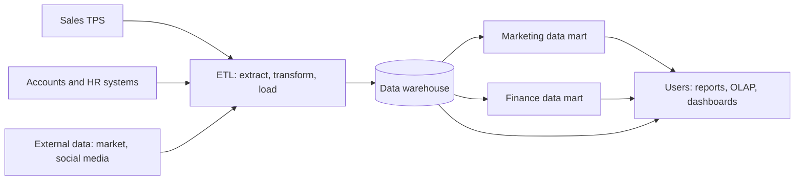

**In simple words:** a data warehouse is one big store of cleaned data from the whole company, kept for analysis. A data mart is a small slice of it for one department. Think of the warehouse as a hotel chain's central kitchen and each data mart as one restaurant's counter. <Cite id="data-management-gfg-dw-vs-dm" />

**Data warehouse:** a central store of current and historical data from many sources, organised for analysis and decisions. Bill Inmon described it as subject-oriented, integrated, time-variant and non-volatile (data is added, not changed or deleted). <Cite id="data-management-tp-dwh-overview" />

**Why it is needed:** running heavy analysis on live billing databases slows real customers down, and the data is spread across many systems in different formats. A warehouse copies it into one place built for analysis.

**Data mart:** a small data warehouse focused on one subject or department, such as marketing or finance. It holds only the data that group needs, so it is cheaper, faster to build and quicker to query. Types: dependent (built from the warehouse), independent (built straight from sources) and hybrid. <Cite id="data-management-ibm-data-mart" />

**Data warehouse versus data mart** <Cite id="data-management-gfg-data-warehousing" />

| Point | Data warehouse | Data mart |
|---|---|---|
| Scope | Whole organisation, many subjects | One department or subject |
| Size | Large | Smaller |
| Sources | Many source systems | Few sources or the warehouse |
| Time and cost | Long and high | Short and low |
| Users | Many groups | One group |
| Design | Usually top-down | Often bottom-up |

**Two examples that show generation of Big Data** <Cite id="data-management-wiki-big-data" />

1. **Retail transactions:** Walmart handles more than 1 million customer transactions an hour, according to figures quoted on Wikipedia. Every bill, item and payment adds to the data.
2. **Social media:** every like, share, comment and photo on Facebook or Instagram is stored, and Wikipedia notes Facebook holds tens of billions of user photos. Similar data comes from e-commerce clicks on Amazon or Flipkart.

These show the three V's: huge volume, high velocity and wide variety (text, photos, numbers).

**Conclusion:** the warehouse gives a company-wide view, marts give each team a fast and focused view, and big data is the raw material that flows into both.
