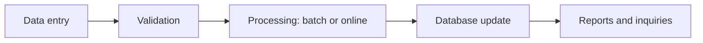
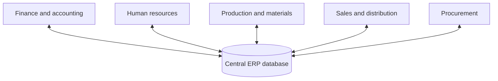

**In simple words:** TPS business ke routine, roz ke transactions record karta hai, jaise ek sale ya deposit. ERP company ke saare departments ko ek shared database pe jodta hai, taaki data ek baar enter ho aur sab use karein.

**1. Transaction Processing System (TPS)**

**Definition:** TPS ek information system hai jo business ke routine, day-to-day transactions ko fixed, programmed tareeke se record aur process karta hai. Users operational staff hote hain. <Cite id="note-tps-fais-erp-wiki-tps" />

**Processing modes:** **batch** mode mein transactions jama hote hain aur baad mein saath process hote hain (monthly payroll run). **Online** mode mein har transaction turant process hota hai (ATM withdrawal ya train ticket booking). <Cite id="note-tps-fais-erp-includehelp-tps" />

**Features:** high volume, fast aur predictable, bahut reliable (data lose nahi hona chahiye), sirf structured transactions, aur ye MIS jaise higher systems ko data deta hai.

**Examples:** SBI ke deposits aur withdrawals, supermarket billing, railway reservation, payroll.

**2. Enterprise Resource Planning (ERP)**

**Definition:** ERP aisa software hai jo company ke main business processes (finance, HR, production, purchase, sales) ko ek system mein, ek central database ke saath jodta hai. <Cite id="note-tps-fais-erp-wiki-erp" />

**Ye kyun zaroori hai:** jab har department ka apna system hota hai to ek hi customer kai baar store hota hai, numbers match nahi karte aur orders dobara type karne padte hain. ERP ye hata deta hai. <Cite id="note-tps-fais-erp-oracle-erp" />

**Advantages:** one version of the truth, duplicate kaam kam, tez decisions, behtar planning. **Disadvantages:** bahut high cost, lamba implementation, staff ko kaam ki aadatein badalni padti hain, ek vendor pe dependence. <Cite id="note-tps-fais-erp-tp-erp" />

**Examples:** SAP, Oracle ERP aur Microsoft Dynamics.

**Dono ka link:** TPS raw transactions collect karta hai, aur ERP unhe saare departments mein use aur share karta hai.

**Conclusion:** TPS wo base hai jo business events record karta hai, aur ERP wo integrated platform hai jisse poori company ek hi data pe kaam karti hai.
