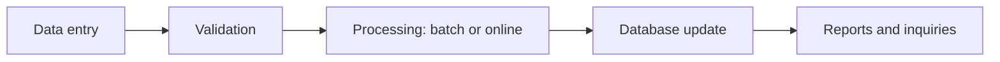
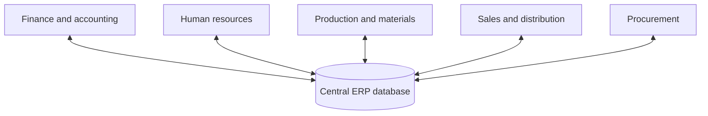

**In simple words:** a TPS records the routine, everyday transactions of a business, such as a sale or a deposit. An ERP joins all departments of a company on one shared database so that data is entered once and used by everyone.

**1. Transaction Processing System (TPS)**

**Definition:** a TPS is an information system that records and processes the routine, day-to-day transactions of a business in a fixed, programmed way. Users are operational staff. <Cite id="note-tps-fais-erp-wiki-tps" />

**Processing modes:** in **batch** mode transactions are collected and processed together later (a monthly payroll run). In **online** mode each transaction is processed at once (an ATM withdrawal or a train ticket booking). <Cite id="note-tps-fais-erp-includehelp-tps" />

**Features:** high volume, fast and predictable, very reliable (it must not lose data), only structured transactions, and it feeds data to higher systems such as MIS.

**Examples:** SBI deposits and withdrawals, billing at a supermarket, railway reservation, payroll.

**2. Enterprise Resource Planning (ERP)**

**Definition:** ERP is software that integrates the main business processes of a company (finance, HR, production, purchase, sales) into one system with one central database. <Cite id="note-tps-fais-erp-wiki-erp" />

**Why it is needed:** when each department has its own system, the same customer is stored many times, numbers do not match and orders are re-typed. ERP removes this. <Cite id="note-tps-fais-erp-oracle-erp" />

**Advantages:** one version of the truth, less duplicate work, faster decisions, better planning. **Disadvantages:** very high cost, long implementation, staff must change work habits, dependence on one vendor. <Cite id="note-tps-fais-erp-tp-erp" />

**Examples:** SAP, Oracle ERP and Microsoft Dynamics.

**Link between the two:** the TPS collects the raw transactions, and the ERP uses and shares them across all departments.

**Conclusion:** TPS is the base that records business events, and ERP is the integrated platform that lets the whole company work from the same data.
