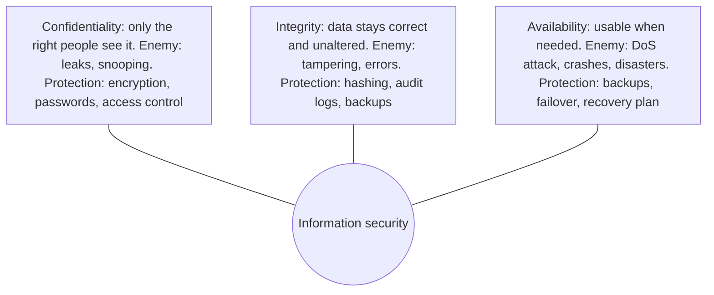

**In simple words:** information security ka maqsad data ke baare mein teen promises nibhana hai: sirf sahi log use dekh sakein (confidentiality), wo sahi rahe (integrity), aur zaroorat pe ready mile (availability). In teeno ko milake CIA triad kehte hain. <Cite id="note-information-security-gfg-cia" />

**Definition:** information security information aur information systems ko unauthorized access, use, disclosure, modification ya destruction se bachana hai. <Cite id="note-information-security-gfg-infosec" />

**1. Confidentiality:** private information ko unauthorized logon se door rakhti hai. Iske bina hacker customers ke card numbers padh sakta hai ya employee salary sheet share kar sakta hai. Ye encryption, strong authentication (password plus OTP), access control aur VPN se milti hai. <Cite id="note-information-security-tp-ism" />

**2. Integrity:** data ko complete, accurate rakhti hai aur sirf authorized log hi use badal sakte hain. Iske bina koi marks entry ya bank balance badal sakta hai, aur galat data pe liye gaye decisions galat ho jaate hain. Ye hash checks, digital signatures, input validation, audit logs aur version control se milti hai.

**3. Availability:** pakka karti hai ki authorized users ko zaroorat pe systems aur data mil sakein. Iske bina sale ke din DDoS attack shopping site ko down kar sakta hai aur lakhon ka nuksaan ho sakta hai. Ye backups, redundant servers (failover), DDoS protection aur disaster recovery plan se milti hai.

| Goal | Failure example | Typical controls |
|---|---|---|
| Confidentiality | Online store se card numbers chori | Encryption, access control, VPN |
| Integrity | Attacker ne bank balance badal diya | Hashing, digital signatures, audit logs |
| Availability | Sale ke time website down | Backup, failover, DDoS protection |

<Cite id="note-information-security-nist-800-53" />

**Evaluation:** teeno goals kabhi-kabhi ek doosre ke khilaf kheenchte hain. Safe mein band bina network wala computer bahut confidential hai par available nahi. Bahut zyada checks staff ko slow kar dete hain. Isliye security safety, cost aur ease of use ka balance hai, aur sahi mix data pe depend karta hai: hospital record mein confidentiality aur integrity zyada zaroori hain, jabki railway booking site mein availability. Kuch books authenticity aur non-repudiation ko bhi goals mein jodti hain.

**Example:** online banking mein encryption aur OTP confidentiality bachate hain, transaction checks aur logs integrity bachate hain, aur backup servers app ko available rakhte hain.

**Conclusion:** CIA security ke teen pillars hain, aur ek pillar kamzor ho to poora system unsafe ho jaata hai.
