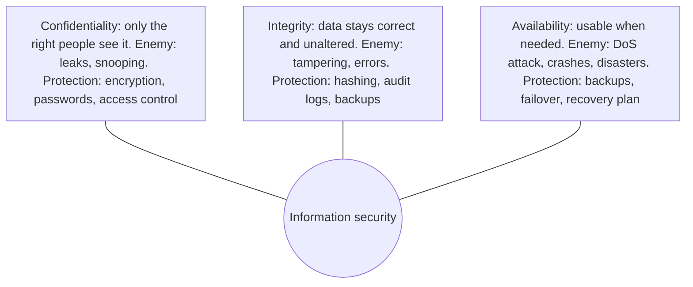

**In simple words:** the aim of information security is to keep three promises about data: only the right people can see it (confidentiality), it stays correct (integrity), and it is ready when needed (availability). Together they are called the CIA triad. <Cite id="note-information-security-gfg-cia" />

**Definition:** information security is the protection of information and information systems from unauthorized access, use, disclosure, modification or destruction. <Cite id="note-information-security-gfg-infosec" />

**1. Confidentiality:** keeps private information away from unauthorized people. Without it, a hacker can read customers' card numbers or an employee can share a salary sheet. It is achieved by encryption, strong authentication (password plus OTP), access control and VPNs. <Cite id="note-information-security-tp-ism" />

**2. Integrity:** keeps data complete, accurate and changed only by authorized people. Without it, someone could alter a marks entry or a bank balance, and decisions made from the wrong data go wrong. It is achieved by hash checks, digital signatures, input validation, audit logs and version control.

**3. Availability:** makes sure authorized users can reach systems and data when needed. Without it, a DDoS attack can take a shopping site down on a sale day and cost lakhs of rupees. It is achieved by backups, redundant servers (failover), DDoS protection and a disaster recovery plan.

| Goal | Failure example | Typical controls |
|---|---|---|
| Confidentiality | Card numbers stolen from an online store | Encryption, access control, VPN |
| Integrity | Bank balance changed by an attacker | Hashing, digital signatures, audit logs |
| Availability | Website down during a sale | Backup, failover, DDoS protection |

<Cite id="note-information-security-nist-800-53" />

**Evaluation:** the three goals sometimes pull against each other. A computer locked in a safe with no network is very confidential but not available. Too many checks can slow staff down. So security is a balance of safety, cost and ease of use, and the right mix depends on the data: a hospital record stresses confidentiality and integrity, while a railway booking site stresses availability. Some books add authenticity and non-repudiation as further goals.

**Example:** in online banking, encryption and OTP protect confidentiality, transaction checks and logs protect integrity, and backup servers keep the app available.

**Conclusion:** CIA are the three pillars of security, and a weak pillar makes the whole system unsafe.
