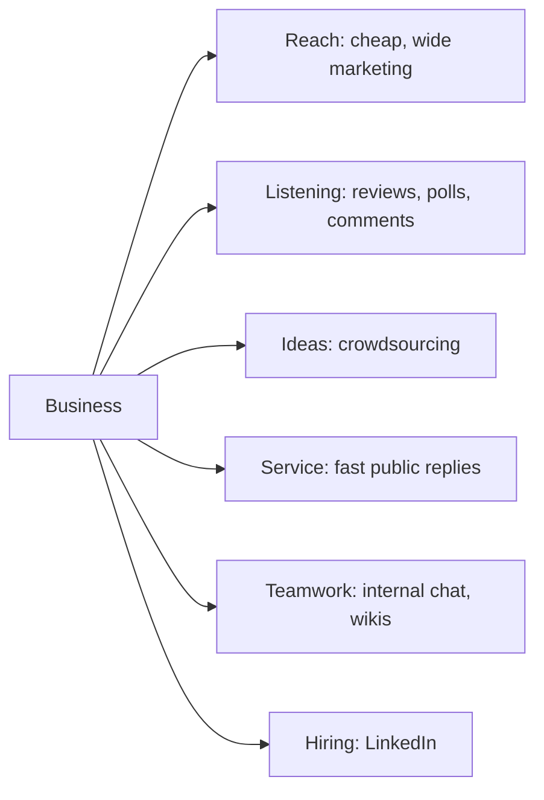

**In simple words:** social computing matlab social tools jaise Facebook, Instagram, WhatsApp, LinkedIn, blogs aur wikis ka use, jahan log milke content banate aur share karte hain. Businesses ko iski zaroorat isliye hai kyunki unke customers, staff aur rivals pehle se wahin hain. <Cite id="social-computing-wiki-social-computing" />

**Definition:** business ke liye social computing ka matlab hai social tools se customers tak pahunchna, unki baat sunna, unhe business mein shamil karna aur staff ko milke behtar kaam karne mein madad karna.

**Purani problem:** pehle company TV, print aur letters se one-way messages bhejti thi. Ye costly aur slow tha, aur company ko wapas kuch kam hi sunai deta tha.

**Businesses ke liye social computing ki zaroorat (reasons)**

| Need | Kaise madad karta hai | Example |
|---|---|---|
| Sasti, badi reach | Ek post ya video kam cost mein hazaron tak pahunchta hai <Cite id="social-computing-wiki-smm" /> | Clothing brand ke Instagram ads |
| Two-way conversation | Firm ko tareef aur complaints turant sunai dete hain | Zomato ka X pe reply |
| Word of mouth se trust | Log ads se zyada reviews aur ratings pe bharosa karte hain | Amazon aur Flipkart reviews |
| Free market research | Posts aur polls dikhate hain ki customers kya chahte hain | Naye flavour pe poll |
| Naye ideas | Customers products suggest aur vote karte hain <Cite id="social-computing-wiki-crowdsourcing" /> | Lego Ideas fan designs ko sets banata hai |
| Behtar service aur loyalty | Quick replies aur customer communities | X pe airline help desk |
| Hiring aur image | Staff dhundhna aur company culture dikhana | LinkedIn job posts |
| Internal teamwork | Staff chat aur wikis mein know-how share karta hai | Company chat tool |
| Speed aur competition | News aur offers minutes mein fail jaate hain; rivals pehle se use kar rahe hain | Flash sale posts |

**Risks jinhe manage karna hai:** kharab experience public mein tezi se failta hai, private data leak ho sakta hai, fake reviews aur rumours gumraah karte hain, aur staff ko channels din bhar dekhne padte hain. Firm ko social media policy aur trained staff chahiye.

**Conclusion:** social computing business ko zyada logon tak pahunchne, unse seekhne aur unhe behtar serve karne mein madad karta hai, aur ab ye luxury nahi, zaroorat hai.
