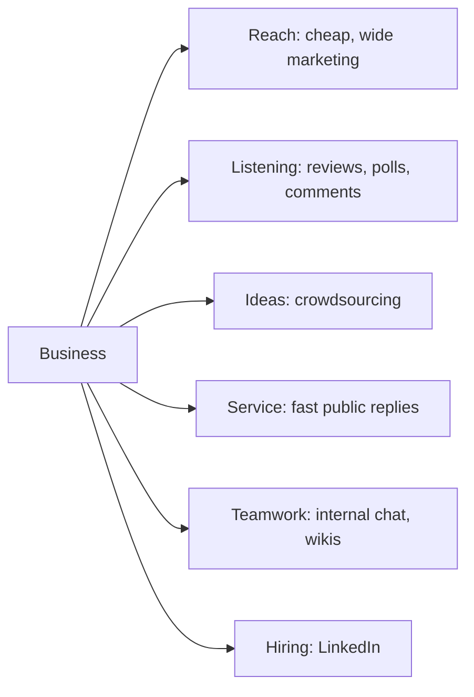

**In simple words:** social computing means using social tools such as Facebook, Instagram, WhatsApp, LinkedIn, blogs and wikis, where people create and share content together. Businesses need it because their customers, staff and rivals are already there. <Cite id="social-computing-wiki-social-computing" />

**Definition:** for a business, social computing means using social tools to reach customers, listen to them, involve them in the business and help staff work together better.

**The old problem:** earlier, a company sent one-way messages through TV, print and letters. It was costly, slow and the company hardly heard back.

**Needs (reasons) of social computing for businesses**

| Need | How it helps | Example |
|---|---|---|
| Cheaper, wider reach | A post or video reaches thousands at low cost <Cite id="social-computing-wiki-smm" /> | Instagram ads of a clothing brand |
| Two-way conversation | The firm hears praise and complaints at once | Zomato replying on X |
| Trust through word of mouth | People trust reviews and ratings more than ads | Amazon and Flipkart reviews |
| Free market research | Posts and polls show what customers want | A poll on a new flavour |
| New ideas | Customers suggest and vote on products <Cite id="social-computing-wiki-crowdsourcing" /> | Lego Ideas turns fan designs into sets |
| Better service and loyalty | Quick replies and customer communities | Airline help desk on X |
| Hiring and image | Find staff and show company culture | LinkedIn job posts |
| Internal teamwork | Staff share know-how in chat and wikis | Company chat tool |
| Speed and competition | News and offers spread in minutes; rivals already use them | Flash sale posts |

**Risks to manage:** a bad experience spreads fast in public, private data can leak, fake reviews and rumours mislead, and staff must watch the channels all day. A firm needs a social media policy and trained staff.

**Conclusion:** social computing helps a business reach more people, learn from them and serve them better, and it is now a necessity rather than a luxury.
