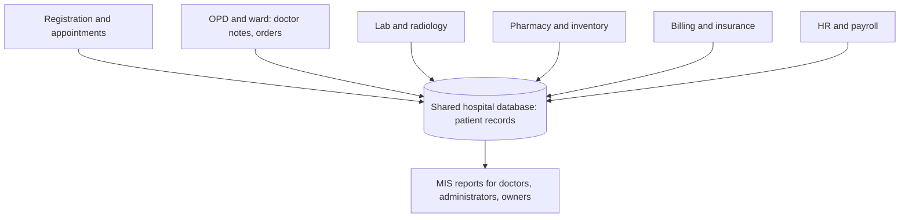

**In simple words:** hospital MIS ek computer system hai jo hospital ke har hisse mein jo hota hai (patients, tests, medicines, bills) use record karta hai aur doctors, nurses aur managers ke liye reports mein badalta hai. <Cite id="is-fundamentals-wiki-his" />

**Aim:** ek patient record, tez service, kam errors, aur beds, staff aur paise ka behtar use.

**Step 1: level ke hisaab se users (hospital hierarchy)**

| Level | Users | Kaunsi information chahiye |
|---|---|---|
| Operational | Receptionists, nurses, lab aur pharmacy staff | Patient details, orders, bills (TPS) |
| Middle | Department heads, ward managers | Bed occupancy, test turnaround, stock reports (MIS) |
| Top | Medical director, owners | Revenue, patient trends, growth plans (dashboards) |

**Step 2: design (modules aur data flow)**

| Module | Kaunse transactions record hote hain | Kaunsi reports banti hain |
|---|---|---|
| Registration | Patient registration, booking | Daily OPD count, waiting time |
| Clinical (OPD, ward) | Admission, diagnosis, treatment, discharge | Bed occupancy, average stay, disease trends |
| Laboratory | Test orders aur results | Tests per day, turnaround time |
| Pharmacy and stores | Drugs ka issue, purchases | Reorder level se kam stock, expiry alerts |
| Billing and finance | Bills, insurance claims, payments | Department ke hisaab se revenue, pending claims |
| Human resources | Duty roster, attendance, payroll | Staff per shift, overtime |

<Cite id="it-impact-society-tp-mis" />

**Step 3: build aur run.** Users se requirements lo, database design karo, software build ya buy karo, test karo, staff ko train karo, go live karo (behtar hai ek-ek module karke), phir maintain karo. Backup rakho taaki system down ho tab bhi hospital kaam kar sake.

**Benefits:** ek patient record, quick billing, medicine aur test ki kam errors, beds aur staff ki behtar planning, aur achhe management decisions. <Cite id="note-tps-fais-erp-wiki-mis" />

**Challenges:** patient data private rakhna hai (sirf authorised staff record khol sakein), setup cost, staff training, aur emergency mein downtime, jiske liye backup power aur data chahiye.

**Example report:** ek exception report jo expire hone wali medicines ki list deti hai, taaki pharmacy time pe action le.

**Conclusion:** hospital MIS saare departments ko ek shared database se jodta hai, aur har insaan ko wo information deta hai jo patients ke treatment aur hospital chalane ke liye chahiye.
