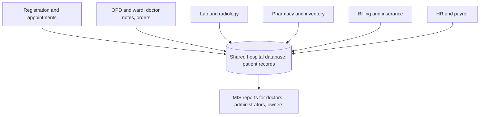

**In simple words:** a hospital MIS is a computer system that records what happens in every part of a hospital (patients, tests, medicines, bills) and turns it into reports for doctors, nurses and managers. <Cite id="is-fundamentals-wiki-his" />

**Aim:** one patient record, faster service, fewer errors, and better use of beds, staff and money.

**Step 1: users by level (hospital hierarchy)**

| Level | Users | Information needed |
|---|---|---|
| Operational | Receptionists, nurses, lab and pharmacy staff | Patient details, orders, bills (TPS) |
| Middle | Department heads, ward managers | Bed occupancy, test turnaround, stock reports (MIS) |
| Top | Medical director, owners | Revenue, patient trends, growth plans (dashboards) |

**Step 2: design (modules and data flow)**

| Module | Transactions recorded | Reports produced |
|---|---|---|
| Registration | Patient registration, booking | Daily OPD count, waiting time |
| Clinical (OPD, ward) | Admission, diagnosis, treatment, discharge | Bed occupancy, average stay, disease trends |
| Laboratory | Test orders and results | Tests per day, turnaround time |
| Pharmacy and stores | Issue of drugs, purchases | Stock below reorder level, expiry alerts |
| Billing and finance | Bills, insurance claims, payments | Revenue per department, pending claims |
| Human resources | Duty roster, attendance, payroll | Staff per shift, overtime |

<Cite id="it-impact-society-tp-mis" />

**Step 3: build and run.** Collect requirements from users, design the database, build or buy the software, test it, train staff, go live (preferably one module at a time) and then maintain it. Keep backups so the hospital can work even if the system is down.

**Benefits:** a single patient record, quick billing, fewer medicine and test errors, better planning of beds and staff, and sound management decisions. <Cite id="note-tps-fais-erp-wiki-mis" />

**Challenges:** patient data must be kept private (only authorised staff may open a record), setup cost, staff training, and downtime in an emergency, which needs backup power and data.

**Example report:** an exception report that lists medicines about to expire, so the pharmacy can act in time.

**Conclusion:** a hospital MIS joins all departments through one shared database, giving each person the information they need to treat patients and run the hospital well.
