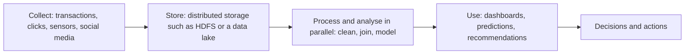

**In simple words:** big data matlab itna bada, tez ya alag-alag tarah ka data ki normal databases use reasonable time mein store aur analyse nahi kar sakte. School canteen 200 students ko ek counter se khila sakti hai, par 50,000 logon ke stadium ke liye bilkul alag system chahiye. <Cite id="data-management-ibm-big-data" />

**Definition:** big data aise data sets ka collection hai jo itne bade, tezi se aane wale ya varied hain ki traditional software unhe aasaani se capture, store aur analyse nahi kar sakta. NIST kehta hai ki iske volume, velocity aur variety ko handle karne ke liye nayi scalable architectures chahiye. <Cite id="data-management-wiki-big-data" /> <Cite id="data-management-nist-bigdata-defs" />

**Sources:** retail transactions (Walmart), social media (Facebook, Instagram), e-commerce clicks (Amazon, Flipkart), food delivery orders aur rider locations (Zomato), sensors aur IoT devices, bank aur stock-market data, hospital scans.

**Characteristics (V's)** <Cite id="data-management-gfg-6vs" />

| V | Meaning | Example |
|---|---|---|
| Volume | Bahut zyada, terabytes se petabytes | Supermarket chain ki saalon ki har sale |
| Velocity | Data bahut tezi se aata hai aur near real-time handle karna padta hai | Card payments ka fraud check jaise-jaise hote hain |
| Variety | Structured, semi-structured aur unstructured forms | Sales rows, reviews, photos aur sensor readings ek saath |
| Veracity | Data kitna accurate aur trustworthy hai | Fake reviews, duplicate records |
| Value | Usse milne wali useful insight | Behtar product recommendations |
| Variability | Meaning ya flow time ke saath badalta hai | Sale ke time traffic spike |

Alag-alag books 3, 5 ya 6 V's ginti hain; explain karo to sab theek hain.

**Big data ke challenges** <Cite id="data-management-aws-big-data" />

1. **Storage:** volume normal databases ke scale hone se tez badhta hai.
2. **Processing speed:** data aate hi analyse karne ke liye Hadoop jaise naye tools chahiye.
3. **Integration:** tables, text, images aur logs ko jodna mushkil hai.
4. **Quality (veracity):** gande, duplicate ya untrusted data se galat results aate hain.
5. **Privacy aur security:** zyadatar data personal hota hai.
6. **Skills shortage:** data scientists aur engineers kam hain.
7. **Cost aur value:** agar useful insight na mile to storage ka kharcha bekaar jaata hai.

**Uses:** Amazon products recommend karta hai, banks fraud pakadte hain, hospitals disease trends predict karte hain, aur Zomato delivery routes plan karta hai.

**Conclusion:** big data ek rich resource hai, par jo firms ise achhe se store, clean aur analyse kar paati hain wahi ise behtar decisions mein badal paati hain.
