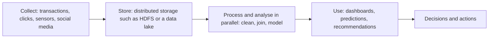

**In simple words:** big data means data that is so large, fast or varied that ordinary databases cannot store and analyse it in reasonable time. A school canteen can feed 200 students with one counter, but a stadium of 50,000 people needs a very different system. <Cite id="data-management-ibm-big-data" />

**Definition:** big data is a collection of data sets so large, fast-arriving or varied that traditional software cannot capture, store and analyse them easily. NIST says new scalable architectures are needed to handle its volume, velocity and variety. <Cite id="data-management-wiki-big-data" /> <Cite id="data-management-nist-bigdata-defs" />

**Sources:** retail transactions (Walmart), social media (Facebook, Instagram), e-commerce clicks (Amazon, Flipkart), food delivery orders and rider locations (Zomato), sensors and IoT devices, bank and stock-market data, hospital scans.

**Characteristics (the V's)** <Cite id="data-management-gfg-6vs" />

| V | Meaning | Example |
|---|---|---|
| Volume | Huge amount, terabytes to petabytes | Years of every sale of a supermarket chain |
| Velocity | Data arrives very fast and needs near real-time handling | Card payments checked for fraud as they happen |
| Variety | Structured, semi-structured and unstructured forms | Sales rows, reviews, photos and sensor readings together |
| Veracity | How accurate and trustworthy the data is | Fake reviews, duplicate records |
| Value | The useful insight it gives | Better product recommendations |
| Variability | Meaning or flow changes over time | Traffic spike during a sale |

Different books count 3, 5 or 6 V's; all are fine if explained.

**Challenges of big data** <Cite id="data-management-aws-big-data" />

1. **Storage:** volumes grow faster than ordinary databases can scale.
2. **Processing speed:** analysing data as it arrives needs new tools such as Hadoop.
3. **Integration:** combining tables, text, images and logs is hard.
4. **Quality (veracity):** dirty, duplicate or untrusted data gives wrong results.
5. **Privacy and security:** much of the data is personal.
6. **Skills shortage:** data scientists and engineers are scarce.
7. **Cost and value:** storage spending is wasted if no useful insight is found.

**Uses:** Amazon recommends products, banks detect fraud, hospitals predict disease trends, and Zomato plans delivery routes.

**Conclusion:** big data is a rich resource, but only firms that can store, clean and analyse it well turn it into better decisions.
