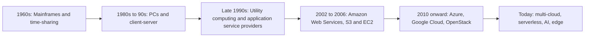

**In simple words:** cloud computing matlab computing resources (servers, storage, software) ko internet pe, on demand use karna, aur sirf jitna use karo utna pay karna, unhe khud rakhne ki jagah. Ye apna generator chalane ki jagah electricity grid use karne jaisa hai. <Cite id="note-cloud-computing-gfg-models" />

**Definition:** NIST cloud computing ko aise model ke roop mein define karta hai jismein configurable computing resources ke shared pool ka convenient, on-demand network access milta hai, jo kam management effort mein jaldi diya aur wapas liya ja sakta hai. <Cite id="note-cloud-computing-nist-800-145" />

**Cloud computing ka evolution** <Cite id="note-cloud-computing-wiki-cloud" />

Har stage ne pichhle stage ki ek problem solve ki. Time-sharing ne kai users ko ek costly mainframe share karne diya. PCs aur client-server ne har company ko apni machines di, par cost zyada aur capacity idle rehti thi. Utility computing ne computing ko electricity ki tarah rent aur meter karne ki koshish ki. Phir AWS ne 2006 mein ise practical banaya, aur doosre follow karte gaye.

**Cloud service models** <Cite id="note-cloud-computing-ibm-models" />

| Model | Kya milta hai | Aap kya manage karte ho | Example |
|---|---|---|---|
| IaaS (Infrastructure as a Service) | Virtual machines, storage, network | OS, apps, data | AWS EC2, Azure VMs |
| PaaS (Platform as a Service) | Apps banane aur chalane ka platform | Apps aur data | Google App Engine, Heroku |
| SaaS (Software as a Service) | Taiyaar application | Sirf settings aur data | Salesforce, Microsoft 365, Zoom |
| CaaS (Containers as a Service) | Containers chalane ka platform | Containers aur unke apps | Amazon ECS, Google Kubernetes Engine |

Analogy: IaaS khaali kitchen rent karna hai, PaaS ingredients aur tools wali kitchen hai, SaaS taiyaar khana order karna hai.

**Cloud deployment models** <Cite id="note-cloud-computing-gfg-deploy" />

| Model | Meaning | Example |
|---|---|---|
| Public | Provider ka hai aur kai customers share karte hain | AWS pe ek start-up |
| Private | Ek organisation ke liye dedicated | Bank ka apna data center |
| Hybrid | Private aur public cloud jude hue | Bank core data private rakhta hai aur peak load ke liye public cloud use karta hai |
| Community | Common needs wali organisations share karti hain | Kai hospitals ya universities ka ek cloud |

**Benefits:** kam upfront cost, pay per use, quick scaling, hardware upkeep nahi. **Risks:** security aur privacy ki chinta, vendor lock-in, internet pe dependence.

**Conclusion:** cloud time-sharing se utility computing tak dheere-dheere bana, aur uske service aur deployment models har firm ko choose karne dete hain ki kitna manage karna hai aur cloud kaun share karega.
