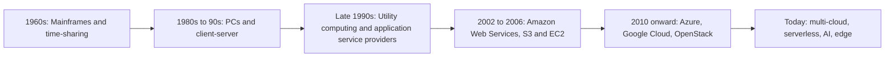

**In simple words:** cloud computing means using computing resources (servers, storage, software) over the internet, on demand, and paying only for what you use, instead of owning them. It is like using the electricity grid instead of running your own generator. <Cite id="note-cloud-computing-gfg-models" />

**Definition:** NIST defines cloud computing as a model for convenient, on-demand network access to a shared pool of configurable computing resources that can be quickly provided and released with little management effort. <Cite id="note-cloud-computing-nist-800-145" />

**Evolution of cloud computing** <Cite id="note-cloud-computing-wiki-cloud" />

Each stage solved a problem of the one before. Time-sharing let many users share one costly mainframe. PCs and client-server gave each company its own machines, but with high cost and idle capacity. Utility computing tried to rent and meter computing like electricity. AWS then made it practical in 2006, and others followed.

**Cloud service models** <Cite id="note-cloud-computing-ibm-models" />

| Model | What you get | You manage | Example |
|---|---|---|---|
| IaaS (Infrastructure as a Service) | Virtual machines, storage, network | OS, apps, data | AWS EC2, Azure VMs |
| PaaS (Platform as a Service) | Platform to build and run apps | Apps and data | Google App Engine, Heroku |
| SaaS (Software as a Service) | Finished application | Only settings and data | Salesforce, Microsoft 365, Zoom |
| CaaS (Containers as a Service) | Platform to run containers | Containers and their apps | Amazon ECS, Google Kubernetes Engine |

Analogy: IaaS is renting an empty kitchen, PaaS is a kitchen with ingredients and tools, SaaS is ordering the finished meal.

**Cloud deployment models** <Cite id="note-cloud-computing-gfg-deploy" />

| Model | Meaning | Example |
|---|---|---|
| Public | Owned by a provider and shared by many customers | A start-up on AWS |
| Private | Dedicated to one organisation | A bank's own data center |
| Hybrid | Private and public clouds joined together | A bank keeps core data private and uses public cloud for peak load |
| Community | Shared by organisations with common needs | Several hospitals or universities sharing one cloud |

**Benefits:** low upfront cost, pay per use, quick scaling, no hardware upkeep. **Risks:** security and privacy worries, vendor lock-in, dependence on internet.

**Conclusion:** cloud grew step by step from time-sharing to utility computing, and its service and deployment models let each firm choose how much to manage and who shares its cloud.
