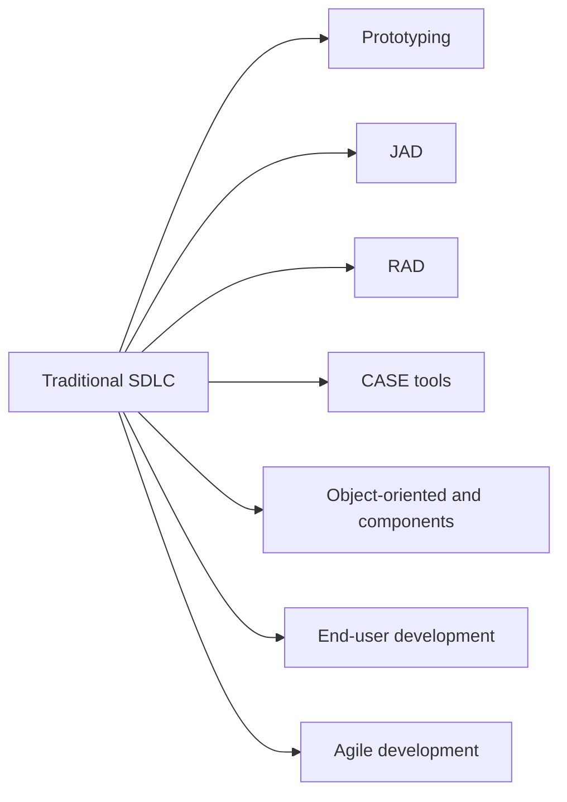

**In simple words:** traditional SDLC (system development life cycle) slow aur rigid hota hai: users ko system sirf end mein dikhta hai, aur late changes bahut costly hote hain. Isko faster, cheaper ya users ki need ke kareeb banane ke liye kuch tools aur methods add kiye jaate hain. <Cite id="it-impact-society-rainer-iis7" loc="Ch. 1" />

1. **Prototyping:** ek chhota working model banao, users ko dikhao, feedback lo aur improve karo. Isse misunderstandings jaldi pakdi jaati hain, jaise building banne se pehle sample flat dikhana. <Cite id="note-sdlc-gfg-prototype" />
2. **Joint application design (JAD):** ek workshop jahan users, managers aur analysts saath baithkar kuch din mein requirements agree karte hain, bahut saari alag interviews ki jagah.
3. **Rapid application development (RAD):** prototyping, JAD, CASE tools aur reusable parts ko short time-boxes ke saath jodta hai, taaki working system hafton ya mahino mein mil jaaye. <Cite id="note-sdlc-wiki-rad" />
4. **CASE tools:** software jo developers ko diagrams banane, requirements repository rakhne, code aur documentation generate karne aur consistency check karne mein help karta hai. Upper CASE analysis aur design mein, lower CASE coding aur testing mein help karta hai. <Cite id="note-sdlc-wiki-case" />
5. **Object-oriented aur component-based development:** system reusable objects aur components se banta hai, isliye reuse se time aur bugs bachte hain.
6. **End-user development:** users spreadsheets ya low-code tools se chhoti applications khud banate hain. Ye fast aur cheap hai, lekin errors aur security gaps se bachne ke liye control chahiye.
7. **Agile development:** system chhote cycles (sprints) mein, kuch hafton ke, banta hai; users har working piece review karte hain aur needs badalne par plan badal dete hain.

| Tool | Benefit | Limit |
|---|---|---|
| Prototyping | Early user feedback | Quick model ko final system samajh liya ja sakta hai |
| JAD | Fast agreement | Sab key logon ka ek saath hona zaroori |
| RAD | Fast delivery | Bahut bade systems ke liye nahi |
| CASE | Kam manual kaam | Costly, training chahiye |
| Agile | Badalti needs sambhalta hai | Users ko hamesha involve rakhna padta hai |

**Conclusion:** ye tools SDLC ke phases rakhte hain, lekin unhe chhota karte hain aur users ko pehle se involve karte hain.
