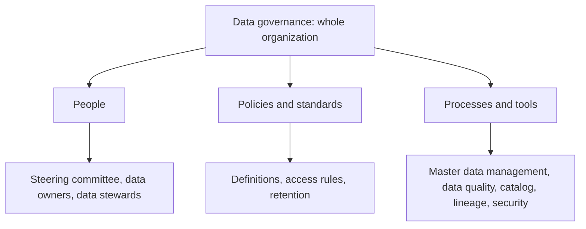

**In simple words:** a database stores data, but it does not decide who owns the data, what it means, how good it must be or who may see it. The approach that manages information across the entire organization is **data governance**. Think of traffic rules for a city: roads alone are not enough, you also need rules, signs and traffic police. <Cite id="data-management-wiki-data-governance" />

**Definition:** data governance is the set of policies, standards, roles and processes that decide how data is created, stored, used, protected and retired across the whole organization. IBM describes it as managing the quality, security and availability of data. <Cite id="data-management-ibm-data-governance" />

**Categories of the approach**

1. **People:** a steering committee or chief data officer sets strategy; data owners (business managers) are accountable for one area of data; data stewards do the daily care.
2. **Policies and standards:** common definitions (for example what counts as an "active customer"), naming and format rules, access rules and how long data is kept.
3. **Processes and tools:** master data management (one trusted "golden record" per customer or product), data quality checks, a data catalog, lineage tracking and access security. <Cite id="data-management-ibm-mdm" /> <Cite id="data-management-gfg-mdm" />

**Benefits:** one version of the truth, better data quality, lower risk of leaks and easier compliance with laws such as GDPR and India's DPDP Act.

**Example:** a bank uses one customer record in its loan, card and mobile app systems, and only authorized staff can see it.

**Conclusion:** data governance, supported by master data management, manages information as an asset across the entire organization.
