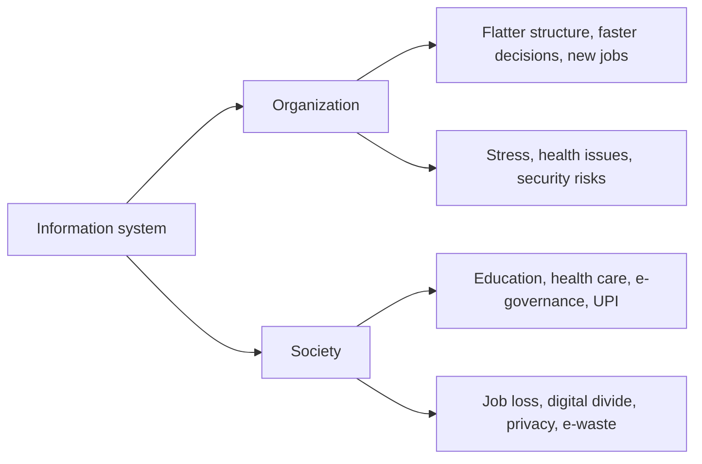

**In simple words:** information system (IS) people, hardware, software, data aur procedures ka set hai jo information collect, process aur share karta hai. Firm ke andar ye structure, jobs aur decisions badalta hai. Firm ke bahar ye logon ke jeene, seekhne, shopping karne aur health care lene ka tarika badalta hai. Ye town mein bijli jaisa hai: ghar aur schools roshan karti hai, lekin unsafe wiring nuksan karti hai aur jin gharon mein connection nahi wo peeche reh jaate hain. <Cite id="it-impact-society-rainer-iis7" loc="Ch. 1" />

**Part 1: organizations pe impact**

1. **Flatter structure:** systems reports collect aur summarize karte hain, isliye kam middle managers chahiye aur ek manager zyada logon ko supervise karta hai.
2. **Better aur faster decisions:** managers ko kagaz ke dher ki jagah summaries aur dashboards milte hain.
3. **Business processes badalte hain:** kaam system ke around redesign hota hai, kabhi kabhi radically (business process re-engineering).
4. **Better coordination:** departments ek database share karte hain, isliye sales, stores aur accounts ko same numbers dikhte hain.
5. **Jobs badalti hain:** routine jobs automate hoti hain aur developers, analysts aur security staff ke naye jobs aate hain.
6. **Employee health:** screen pe zyada der baithne se eye strain, back pain aur repetitive strain injury hoti hai, isliye ergonomics zaroori hai.
7. **Naye risks:** systems pe dependence, cyber attacks aur data breaches. <Cite id="it-impact-society-gfg-media-society" />

**Part 2: society pe impact**

1. **Quality of life:** online shopping, banking, booking aur government services se time aur travel bachta hai.
2. **Robots aur automation:** robots khatarnak ya repetitive kaam karte hain, jaise car factories mein welding aur warehouses mein picking.
3. **Health care:** electronic health records, online consultation (telehealth) aur health apps doctors ko door ke patients tak pahunchne mein help karte hain. <Cite id="it-impact-society-wiki-telehealth" />
4. **Education:** NPTEL aur SWAYAM courses aur e-books internet wale kisi bhi insaan tak pahunchte hain.
5. **Government services:** income-tax e-filing aur UPI payments se queues aur paperwork kam hota hai.
6. **Disabled logon ke liye:** assistive technology se wo padh aur kaam kar sakte hain.

| Positive | Negative |
|---|---|
| Convenience, information tak access | Job loss aur reskill ki zaroorat |
| Better health care aur education | Privacy aur security risks |
| Kam cost, wider reach | Digital divide, fake news, e-waste <Cite id="it-impact-society-wiki-digital-divide" /> |

**Conclusion:** information systems organizations aur society dono ko behtar banate hain, lekin managers aur governments ko job change, privacy, security aur equal access sambhalna padta hai.
