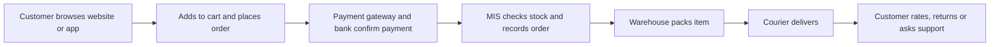

**In simple words:** e-commerce ka matlab hai internet pe goods aur services khareedna aur bechna. Aap Amazon ya Flipkart kholte ho, product chunte ho, UPI se pay karte ho aur wo ghar pe aa jaata hai, shop gaye bina. <Cite id="e-commerce-wiki-ecommerce" />

**Definition:** e-commerce computer networks, mainly internet, ke through products, services ya information ka buying, selling aur exchange hai. Ye e-business ka ek part hai, jisme internal activities bhi aati hain jaise supply chain chalana aur customers ko serve karna. <Cite id="e-commerce-rainer-intro-is" />

**Ye kyun badha:** wide reach, 24 ghante service, kam cost, zyada choice, aasan price comparison, UPI payments aur sasta smartphone aur data.

**Ye kaise kaam karta hai**

1. Customer catalogue search karta hai aur reviews padhta hai.
2. Items cart mein daalta hai aur address deta hai.
3. UPI, card, net banking, wallet ya cash on delivery se pay karta hai.
4. System payment confirm karta hai aur stock count kam karta hai.
5. Warehouse pack karke delivery partner ko deta hai.
6. Customer item receive karta hai; returns, refunds aur reviews uske baad aate hain.

**Types (models)**

| Type | Between | Example |
|---|---|---|
| B2B | Business to business | Infosys software tools khareedna, Alibaba |
| B2C | Business to consumer | Amazon, Flipkart, Zomato |
| C2C | Consumer to consumer | OLX, eBay |
| C2B | Consumer to business | Freelancers firms ko services bechte hain |
| B2G | Business to government | Firms government tenders ke liye bid karti hain |

**Advantages aur disadvantages**

| Advantages | Disadvantages |
|---|---|
| 24 ghante khula, internet wali har jagah pahunch | Product chhu ya try nahi kar sakte, isliye returns zyada |
| Zyada choice, aasan price comparison | Fraud, stolen cards, fake sites |
| Sellers ke liye kam cost | Delivery delay, costly last mile |
| Customer data se personal offers | Privacy concerns |

**Applications:** shopping (Amazon, Flipkart), food delivery (Zomato), travel (IRCTC), banking (SBI YONO), tickets (BookMyShow). <Cite id="e-commerce-gfg-intro" /> <Cite id="e-commerce-ibm" />

**Conclusion:** e-commerce logon ke khareedne aur firms ke bechne ka tarika badalta hai, aur ye tabhi chalta hai jab information system, payments aur delivery teeno reliable hon.
