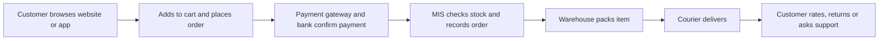

**In simple words:** e-commerce means buying and selling goods and services over the internet. You open Amazon or Flipkart, pick a product, pay by UPI and it arrives at your door, without visiting a shop. <Cite id="e-commerce-wiki-ecommerce" />

**Definition:** e-commerce is the buying, selling and exchange of products, services or information using computer networks, mainly the internet. It is a part of e-business, which also covers internal activities such as running the supply chain and serving customers. <Cite id="e-commerce-rainer-intro-is" />

**Why it grew:** wide reach, service 24 hours a day, lower cost, more choice, easy price comparison, UPI payments and cheap smartphones and data.

**How it works**

1. Customer searches the catalogue and reads reviews.
2. Adds items to the cart and gives the address.
3. Pays by UPI, card, net banking, wallet or cash on delivery.
4. The system confirms payment and reduces the stock count.
5. Warehouse packs and hands over to a delivery partner.
6. The customer receives the item; returns, refunds and reviews follow.

**Types (models)**

| Type | Between | Example |
|---|---|---|
| B2B | Business to business | Infosys buying software tools, Alibaba |
| B2C | Business to consumer | Amazon, Flipkart, Zomato |
| C2C | Consumer to consumer | OLX, eBay |
| C2B | Consumer to business | Freelancers selling services to firms |
| B2G | Business to government | Firms bidding for government tenders |

**Advantages and disadvantages**

| Advantages | Disadvantages |
|---|---|
| Open 24 hours, reaches any place with internet | Cannot touch or try the product, so returns are common |
| Large choice, easy price comparison | Fraud, stolen cards, fake sites |
| Lower cost for sellers | Delivery delay, costly last mile |
| Customer data helps personal offers | Privacy concerns |

**Applications:** shopping (Amazon, Flipkart), food delivery (Zomato), travel (IRCTC), banking (SBI YONO), tickets (BookMyShow). <Cite id="e-commerce-gfg-intro" /> <Cite id="e-commerce-ibm" />

**Conclusion:** e-commerce changes how people buy and firms sell, and it works only when the information system, payments and delivery are all reliable.
