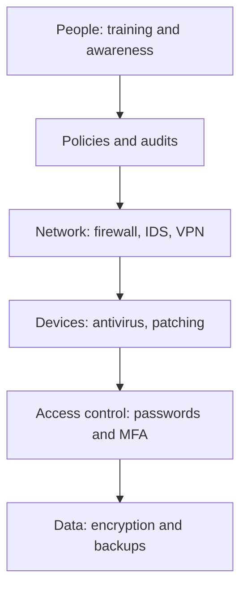

**In simple words:** cyber security ka matlab hai computers, networks aur data ko attack, damage ya theft se bachana. Ye koi ek tool nahi hai. Ye technology, people aur process ka saath kaam karna hai, aur checks baar baar karne padte hain kyunki attackers apne tarike badalte rehte hain. <Cite id="note-information-security-nist-csf" /> <Cite id="note-information-security-ibm-infosec" />

**Ye kyun zaroori hai:** malware, phishing, ransomware aur denial of service jaise threats business rok sakte hain, customer data leak kar sakte hain aur legal trouble la sakte hain. <Cite id="note-information-security-gfg-cyber-attacks" />

**Measures examples ke saath**

| # | Measure | Example |
|---|---|---|
| 1 | Strong passwords aur multi-factor authentication (MFA) | Banking apps password ke saath OTP ya fingerprint maangte hain |
| 2 | Software updates (patching) | 2017 ka Windows patch WannaCry rok sakta tha |
| 3 | Antivirus aur anti-malware | Endpoint protection download mein trojan block karta hai |
| 4 | Firewall aur network security | Company firewall known bad addresses ka traffic block karta hai |
| 5 | Encryption | Flipkart checkout pe HTTPS; encrypted laptop disks |
| 6 | Regular backups, tested | Firm ransomware ke baad bina paise diye files restore kar leti hai |
| 7 | Access control aur least privilege | Clerk payroll database nahi khol sakta |
| 8 | Training aur awareness | Bank staff ke liye mock phishing drills karta hai |
| 9 | Security policy aur audits | Annual audit attackers se pehle open server pakad leta hai |
| 10 | Monitoring aur incident response plan | Security team infected laptop ko minutes mein isolate kar deti hai |
| 11 | Secure development aur testing | Input checks login form pe SQL injection rokte hain |
| 12 | Legal compliance aur reporting | Fraud cyber crime helpline aur CERT-In ko report karna |

<Cite id="note-information-security-cisa-practices" />

**In measures ke advantages:** kam breaches, customer trust aur legal compliance. **Limits:** cost, users ko inconvenience, aur koi bhi measure 100 percent safety nahi deta, isiliye layers use hoti hain.

**Conclusion:** achhi cyber security strong technology, trained people aur clear rules ko jodti hai, aur use continuously review karna padta hai.
