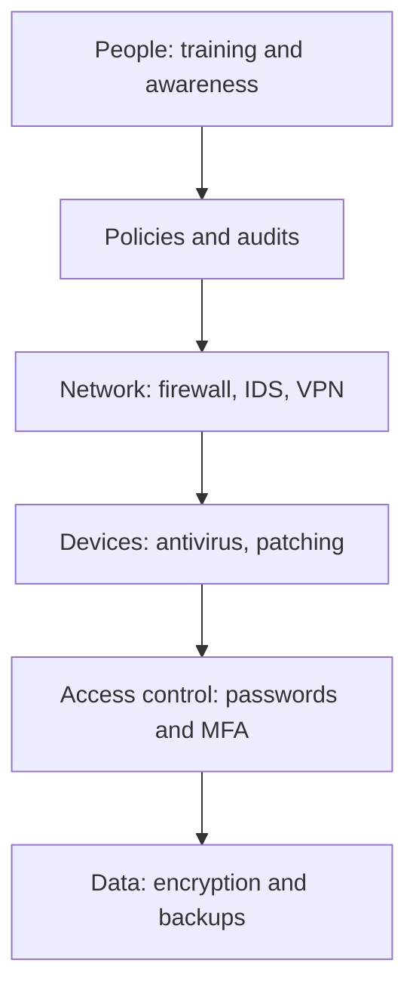

**In simple words:** cyber security means protecting computers, networks and data from attack, damage or theft. It is not one tool. It is technology, people and process working together, with checks repeated all the time because attackers keep changing their methods. <Cite id="note-information-security-nist-csf" /> <Cite id="note-information-security-ibm-infosec" />

**Why it is needed:** threats such as malware, phishing, ransomware and denial of service can stop a business, leak customer data and cause legal trouble. <Cite id="note-information-security-gfg-cyber-attacks" />

**Measures with examples**

| # | Measure | Example |
|---|---|---|
| 1 | Strong passwords and multi-factor authentication (MFA) | Banking apps ask for password plus OTP or fingerprint |
| 2 | Software updates (patching) | The 2017 Windows patch would have blocked WannaCry |
| 3 | Antivirus and anti-malware | Endpoint protection blocks a trojan in a download |
| 4 | Firewall and network security | A company firewall blocks traffic from known bad addresses |
| 5 | Encryption | HTTPS on Flipkart checkout; encrypted laptop disks |
| 6 | Regular backups, tested | A firm restores files after ransomware without paying |
| 7 | Access control and least privilege | A clerk cannot open the payroll database |
| 8 | Training and awareness | A bank runs mock phishing drills for staff |
| 9 | Security policy and audits | An annual audit finds an open server before attackers do |
| 10 | Monitoring and incident response plan | A security team isolates an infected laptop within minutes |
| 11 | Secure development and testing | Input checks stop SQL injection on a login form |
| 12 | Legal compliance and reporting | Reporting fraud to the cyber crime helpline and CERT-In |

<Cite id="note-information-security-cisa-practices" />

**Advantages of these measures:** fewer breaches, customer trust and legal compliance. **Limits:** cost, user inconvenience, and no measure gives 100 percent safety, which is why layers are used.

**Conclusion:** good cyber security combines strong technology, trained people and clear rules, and it must be reviewed continuously.
