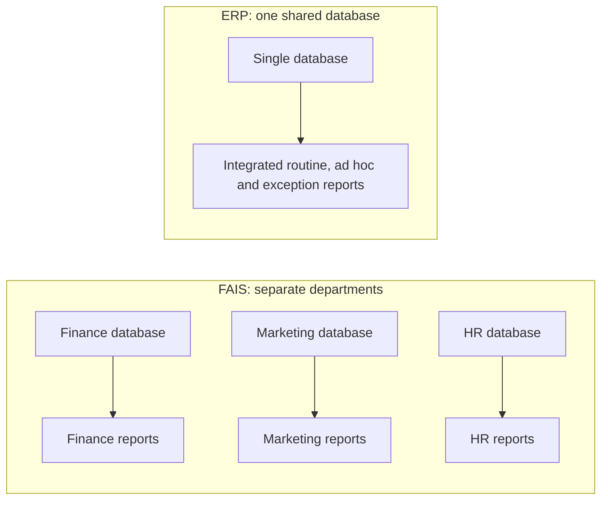

**In simple words:** functional area information system (FAIS) ek department ko serve karta hai, jaise finance, marketing ya HR. Enterprise resource planning (ERP) system saare departments ko ek shared database pe jodta hai. Dono managers ko wahi teen basic types ke reports dete hain, lekin FAIS report ek department ka hissa dikhati hai aur ERP report poori firm ko saath dikhati hai. <Cite id="crm-rainer-iis" />

**Reports ke basic types**

1. **Routine reports:** fixed schedule aur fixed format mein bante hain. Example: daily sales summary, monthly payroll register.
2. **Ad hoc (on-demand) reports:** manager kisi special need ke liye maange tab bante hain. Example: ek city mein pichle hafte ek product ki sales. Ye drill-down (total se uski detail tak), key-indicator (kuch key numbers jaise cash on hand) aur comparative (is saal vs pichla saal) reports ke roop mein aati hain.
3. **Exception reports:** sirf tab bante hain jab koi value limit cross kare. Example: reorder level se kam stock wale items, credit limit se zyada wale accounts.

<Cite id="note-tps-fais-erp-wiki-mis" />

**Comparison: FAIS reports vs ERP reports**

| Point | FAIS reports | ERP reports |
|---|---|---|
| Scope | Ek department | Poori firm, saare departments |
| Data source | Department ka apna database | Sabke liye ek shared database |
| Report types | Routine, ad hoc, exception | Wahi types, lekin har ek finance, stock, sales aur HR ko combine kar sakti hai |
| View | Picture ka ek hissa; departments ke numbers alag ho sakte hain | Truth ka ek version |
| Timing | Aksar periodic (daily, monthly) | Real-time ya near real-time |
| Example | Marketing system ki sales report | Ek report jo order, uska stock, delivery aur payment status saath dikhaye |
| Cost aur effort | Sasta, shuru karna aasan | Costly aur implement karna complex |

<Cite id="note-tps-fais-erp-tp-erp" />

**Similarities:** dono mein wahi teen report types hain, dono planning aur control support karte hain, aur dono transaction data se bante hain.

**Example:** Flipkart mein marketing FAIS report category-wise sales dikhati hai, jabki ERP report wahi order warehouse stock, supplier payments aur delivery status ke saath jodti hai. <Cite id="note-tps-fais-erp-oracle-erp" />

**Conclusion:** report types dono mein same hain, lekin ERP reports integrated aur hamesha consistent hoti hain, jabki FAIS reports ek department tak limited hoti hain.
