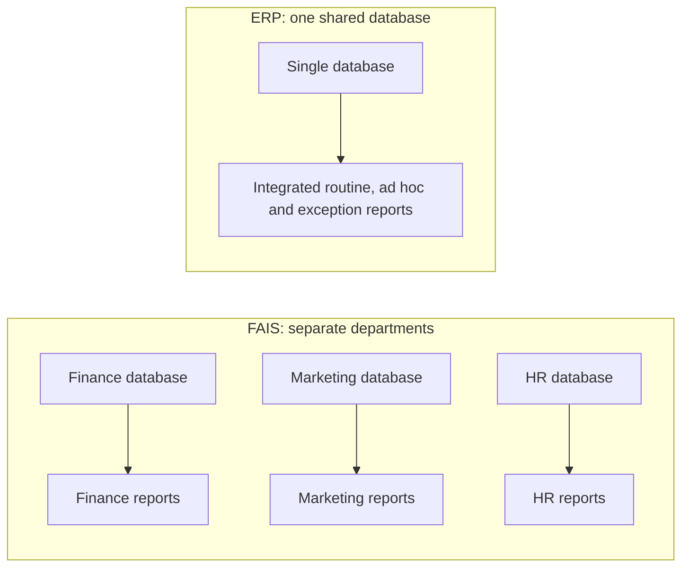

**In simple words:** a functional area information system (FAIS) serves one department such as finance, marketing or HR. An enterprise resource planning (ERP) system joins all departments on one shared database. Both give managers the same three basic kinds of reports, but an FAIS report shows one department's part of the picture and an ERP report shows the whole firm together. <Cite id="crm-rainer-iis" />

**Basic types of reports**

1. **Routine reports:** produced on a fixed schedule and in a fixed format. Example: daily sales summary, monthly payroll register.
2. **Ad hoc (on-demand) reports:** produced when a manager asks for a special need. Example: sales of one product in one city last week. They come as drill-down (from a total to its detail), key-indicator (a few key numbers such as cash on hand) and comparative (this year against last year) reports.
3. **Exception reports:** produced only when a value crosses a limit. Example: items below the reorder level, accounts over their credit limit.

<Cite id="note-tps-fais-erp-wiki-mis" />

**Comparison: FAIS reports versus ERP reports**

| Point | FAIS reports | ERP reports |
|---|---|---|
| Scope | One department | Whole firm, across departments |
| Data source | The department's own database | One shared database for all |
| Report types | Routine, ad hoc, exception | The same types, but each can combine finance, stock, sales and HR |
| View | Part of the picture; numbers may differ between departments | One version of the truth |
| Timing | Often periodic (daily, monthly) | Real-time or near real-time |
| Example | Sales report from the marketing system | One report showing an order, its stock, delivery and payment status |
| Cost and effort | Cheaper, simpler to start | Costly and complex to implement |

<Cite id="note-tps-fais-erp-tp-erp" />

**Similarities:** both use the same three report types, both support planning and control, and both are produced from transaction data.

**Example:** at Flipkart a marketing FAIS report shows sales by category, whereas an ERP report links the same order with warehouse stock, supplier payments and delivery status. <Cite id="note-tps-fais-erp-oracle-erp" />

**Conclusion:** the report types are the same in both, but ERP reports are integrated and always consistent, while FAIS reports are limited to one department.
