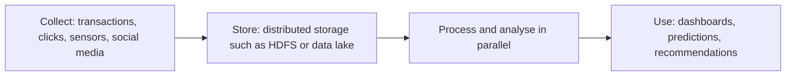

**In simple words:** big data wo data hai jo itna bada, fast ya alag-alag type ka hai ki ordinary database use reasonable time mein capture, store aur analyse nahi kar sakta. School canteen ek counter se 200 students ko serve kar sakti hai, lekin half-time mein 50,000 logon ke stadium ko khilane ke liye alag system chahiye. <Cite id="data-management-wiki-big-data" />

**Definition:** big data aise data sets hain jinka volume, velocity aur variety traditional software ke liye bahut zyada hai. NIST kehta hai ki data growth ordinary analytics se aage nikal rahi hai aur naye scalable architectures chahiye. <Cite id="data-management-nist-bigdata-defs" />

**Characteristics (V's)**

| V | Meaning | Example |
|---|---|---|
| Volume | Bahut zyada amount, terabytes se petabytes | Walmart ke saalon ke har transaction |
| Velocity | Data bahut tez aata hai, aksar near real time mein handle hota hai | Card payments ka fraud check hote hi hote |
| Variety | Structured tables, semi-structured JSON ya XML, unstructured text, images, video | Reviews, photos aur sales rows saath mein |
| Veracity | Data kitna accurate aur trustworthy hai | Fake reviews, duplicate records |
| Value | Data jo useful insight deta hai | Amazon pe better product recommendations |
| Variability | Meaning ya flow time ke saath badalta hai | Sale ke time traffic spike |

Alag books mein 3, 5 ya 6 V's gine jaate hain. Explain karo to sab accepted hain. <Cite id="data-management-gfg-6vs" /> <Cite id="data-management-sas-big-data" />

**Challenges**

1. **Storage:** volume ordinary databases ke scale hone se tez badhta hai.
2. **Processing speed:** data aate hi handle karne ke liye Hadoop jaise naye tools chahiye. <Cite id="data-management-aws-big-data" />
3. **Variety ka integration:** tables, text, images aur logs ko jodna mushkil hai.
4. **Quality (veracity):** untrusted ya dirty data galat results deta hai.
5. **Privacy aur security:** zyadatar data personal hota hai.
6. **Skills shortage:** data scientists aur engineers kam hain.
7. **Cost aur value:** agar useful insight na mile to storage ka kharcha waste hai.

**Applications:** personalised offers (Flipkart), fraud detection (SBI aur dusre banks), demand forecasting (Zomato), health care.

**Conclusion:** big data ko uske V's se describe karte hain aur ye value aur challenges dono lata hai, isliye distributed tools, achhi data quality aur strong privacy controls chahiye.
