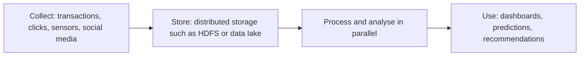

**In simple words:** big data is data so large, fast or varied that an ordinary database cannot capture, store and analyse it in reasonable time. A school canteen can serve 200 students with one counter, but feeding a stadium of 50,000 in the half-time break needs a different system. <Cite id="data-management-wiki-big-data" />

**Definition:** big data means data sets whose volume, velocity and variety are too great for traditional software. NIST notes that data growth is outpacing ordinary analytics and new scalable architectures are needed. <Cite id="data-management-nist-bigdata-defs" />

**Characteristics (the V's)**

| V | Meaning | Example |
|---|---|---|
| Volume | Huge amount, terabytes to petabytes | Years of every transaction of Walmart |
| Velocity | Data arrives very fast, often handled in near real time | Card payments checked for fraud as they happen |
| Variety | Structured tables, semi-structured JSON or XML, unstructured text, images, video | Reviews, photos and sales rows together |
| Veracity | How accurate and trustworthy the data is | Fake reviews, duplicate records |
| Value | The useful insight the data gives | Better product recommendations on Amazon |
| Variability | Meaning or flow changes with time | Traffic spike during a sale |

Different books count 3, 5 or 6 V's. All are accepted if explained. <Cite id="data-management-gfg-6vs" /> <Cite id="data-management-sas-big-data" />

**Challenges**

1. **Storage:** volume grows faster than ordinary databases can scale.
2. **Processing speed:** handling data as it arrives needs new tools such as Hadoop. <Cite id="data-management-aws-big-data" />
3. **Integration of variety:** tables, text, images and logs are hard to combine.
4. **Quality (veracity):** untrusted or dirty data gives wrong results.
5. **Privacy and security:** much of the data is personal.
6. **Skills shortage:** data scientists and engineers are scarce.
7. **Cost and value:** storage spending is wasted if no useful insight comes out.

**Applications:** personalised offers (Flipkart), fraud detection (SBI and other banks), demand forecasting (Zomato), health care.

**Conclusion:** big data is described by its V's and brings both value and challenges, so it needs distributed tools, good data quality and strong privacy controls.
