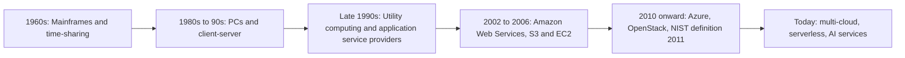

**In simple words:** cloud computing ka matlab hai computing power, storage aur software internet pe rent karna aur sirf use ka paisa dena. Apne servers rakhna car rakhne jaisa hai; cloud Ola ya Uber use karne jaisa hai jahan har ride ka paisa dete ho. NIST ise shared computing resources tak on-demand network access kehta hai, jo kam management effort mein jaldi mil jaate hain. <Cite id="note-cloud-computing-nist-800-145" />

**Cloud computing ka evolution**

1. **Mainframes aur time-sharing (1960s):** kai users ek costly central computer share karte the.
2. **PCs aur client-server (1980s se 90s):** har company ke apne servers the, cost zyada aur capacity idle.
3. **Utility computing aur ASPs (late 1990s):** computing bijli ki tarah rent aur meter hoti thi, lekin technology tayyar nahi thi.
4. **Cloud era (2002 se):** AWS 2002 mein shuru hua aur 2006 mein S3 aur EC2 launch kiye, phir 2010 mein Azure aur OpenStack aaye. <Cite id="note-cloud-computing-wiki-cloud" />

**Service models**

| Point | IaaS | PaaS | SaaS |
|---|---|---|---|
| Kya milta hai | Virtual machines, storage, network | Apps banane aur chalane ka platform | Ready application |
| Aap manage karte ho | OS, middleware, apps, data | Apps aur data | Settings, users, data |
| Users | IT admins | Developers | End users |
| Examples | AWS EC2, Azure VMs | Heroku, Google App Engine | Salesforce, Microsoft 365, Zoom |

<Cite id="note-cloud-computing-gfg-models" /> <Cite id="note-cloud-computing-ibm-models" />

**Deployment models**

| Model | Meaning | Example |
|---|---|---|
| Public | Provider ka, kai customers share karte hain | AWS pe start-up |
| Private | Sirf ek organization ke liye | Bank ka apna data center |
| Hybrid | Private aur public jude hue | Sale ke liye public capacity rent karne wala retailer |
| Community | Common needs wali organizations share karti hain | Hospitals jo compliance-bound cloud share karte hain |

<Cite id="note-cloud-computing-gfg-deploy" />

**Benefits:** kam upfront cost, pay per use, jaldi scaling. **Risks:** security, vendor lock-in aur internet pe dependence.

**Conclusion:** cloud computing time-sharing se utility computing tak badha aur ab IaaS, PaaS aur SaaS ke roop mein public, private, hybrid ya community clouds pe milta hai.
