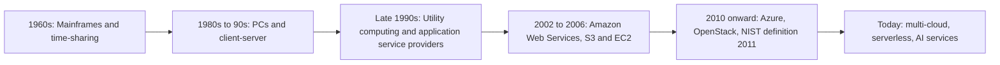

**In simple words:** cloud computing means renting computing power, storage and software over the internet and paying only for what you use. Owning servers is like owning a car; the cloud is like using Ola or Uber and paying per ride. NIST defines it as on-demand network access to a shared pool of computing resources that can be rapidly provided with little management effort. <Cite id="note-cloud-computing-nist-800-145" />

**Evolution of cloud computing**

1. **Mainframes and time-sharing (1960s):** many users shared one costly central computer.
2. **PCs and client-server (1980s to 90s):** each company owned its servers, with high cost and idle capacity.
3. **Utility computing and ASPs (late 1990s):** computing was rented and metered like electricity, but the technology was not ready.
4. **Cloud era (2002 onward):** AWS began in 2002 and launched S3 and EC2 in 2006, followed by Azure and OpenStack in 2010. <Cite id="note-cloud-computing-wiki-cloud" />

**Service models**

| Point | IaaS | PaaS | SaaS |
|---|---|---|---|
| What you get | Virtual machines, storage, network | Platform to build and run apps | Finished application |
| You manage | OS, middleware, apps, data | Apps and data | Settings, users, data |
| Users | IT admins | Developers | End users |
| Examples | AWS EC2, Azure VMs | Heroku, Google App Engine | Salesforce, Microsoft 365, Zoom |

<Cite id="note-cloud-computing-gfg-models" /> <Cite id="note-cloud-computing-ibm-models" />

**Deployment models**

| Model | Meaning | Example |
|---|---|---|
| Public | Owned by a provider, shared by many customers | A start-up on AWS |
| Private | Used by one organization only | A bank's own data center |
| Hybrid | Private and public joined together | A retailer renting public capacity for a sale |
| Community | Shared by organizations with common needs | Hospitals sharing a compliance-bound cloud |

<Cite id="note-cloud-computing-gfg-deploy" />

**Benefits:** low upfront cost, pay per use, quick scaling. **Risks:** security, vendor lock-in and dependence on the internet.

**Conclusion:** cloud computing grew from time-sharing to utility computing and is delivered as IaaS, PaaS and SaaS over public, private, hybrid or community clouds.
