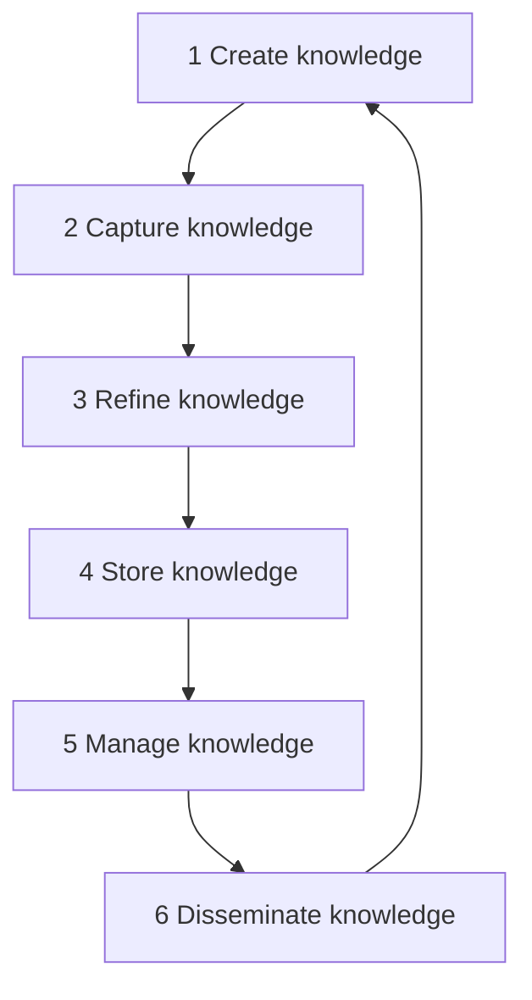

**In simple words:** knowledge management (KM) processes aur tools ka set hai jisse organization apne logon ka knowledge create, capture, store, share aur use karti hai, taaki sahi knowledge sahi insaan tak sahi time pe pahunche. KM life cycle un steps ka sequence hai jinse knowledge create hone se use hone tak guzarta hai. <Cite id="knowledge-management-gfg-intro" /> <Cite id="knowledge-management-ibm" />

**Ye kyun zaroori hai:** jab experienced employee jaata hai, to saalon ka know-how saath chala jaata hai. KM ke bina teams wahi problem phir se zero se solve karti hain.

Rainer ki MIS textbook mein six steps hain. <Cite id="knowledge-management-rainer-mis" />

1. **Create:** naya knowledge tab aata hai jab log kaam ke naye tarike dhoondhte hain ya bahar se laate hain, jaise consultants aur research se. Example: support engineer ek common fault ka faster fix dhoondhta hai.
2. **Capture:** naye knowledge ko valuable pehchaana jaata hai aur reasonable form mein record kiya jaata hai. Example: engineer ka interview hota hai aur fix likh liya jaata hai.
3. **Refine:** knowledge ko context mein rakha jaata hai taaki wo actionable ho, jaise kab kaam karta hai aur kab nahi.
4. **Store:** useful knowledge ek repository mein rakha jaata hai jahan baaki log pahunch sakte hain. Example: article tags ke saath support knowledge base mein add hota hai.
5. **Manage:** library ki books ki tarah knowledge ko regularly review karte hain taaki accurate rahe, aur outdated hone pe update ya remove karte hain.
6. **Disseminate:** knowledge ko useful format mein kisi bhi zarurat wale ko, kahin bhi aur kabhi bhi available karaya jaata hai.

**Analogy:** library. Books likhi jaati hain (create), chuni jaati hain (capture), catalogue hoti hain (refine), shelf pe rakhi jaati hain (store), purani hone pe badli jaati hain (manage) aur readers ko di jaati hain (disseminate). Readers phir nayi books likhte hain.

**Dusre models:** dusre authors similar steps use karte hain, jaise Wiig (build, hold, pool, apply) aur Meyer and Zack (acquisition, refinement, storage, distribution, presentation). Laudon chaar steps batate hain: acquire, store, disseminate aur apply. <Cite id="knowledge-management-tp-cycle" /> <Cite id="knowledge-management-laudon-mis" />

**Example:** Infosys project lessons ko shared knowledge base mein rakhta hai taaki naye teams unhe reuse karein.

**Conclusion:** KM life cycle create, capture, refine, store, manage aur disseminate ka loop hai, aur ye repeat hota hai kyunki knowledge badalta rehta hai.
