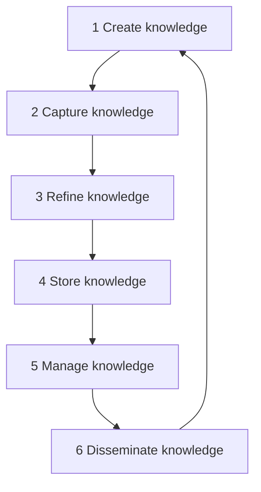

**In simple words:** knowledge management (KM) is the set of processes and tools an organization uses to create, capture, store, share and use what its people know, so the right knowledge reaches the right person at the right time. The KM life cycle is the sequence of steps through which knowledge moves, from being created to being used. <Cite id="knowledge-management-gfg-intro" /> <Cite id="knowledge-management-ibm" />

**Why it is needed:** when an experienced employee leaves, years of know-how leave with them. Without KM, teams also solve the same problem again from zero.

Rainer's MIS textbook describes six steps. <Cite id="knowledge-management-rainer-mis" />

1. **Create:** new knowledge appears when people find new ways of working or when it is brought in from outside, such as consultants and research. Example: a support engineer discovers a faster fix for a common fault.
2. **Capture:** the new knowledge is recognised as valuable and recorded in a reasonable form. Example: the engineer is interviewed and the fix is written up.
3. **Refine:** the knowledge is placed in context so that it is actionable, including when it works and when it does not.
4. **Store:** useful knowledge is put in a repository that others can reach. Example: the article is added to the support knowledge base with tags.
5. **Manage:** like books in a library, knowledge is reviewed regularly to keep it accurate, and removed or updated when it is outdated.
6. **Disseminate:** knowledge is made available in a useful format to anyone who needs it, anywhere and at any time.

**Analogy:** a library. Books are written (create), selected (capture), catalogued (refine), shelved (store), replaced when outdated (manage) and lent out (disseminate). Readers then write new books.

**Other models:** other authors use similar steps, for example Wiig (build, hold, pool, apply) and Meyer and Zack (acquisition, refinement, storage, distribution, presentation). Laudon describes four steps: acquire, store, disseminate and apply. <Cite id="knowledge-management-tp-cycle" /> <Cite id="knowledge-management-laudon-mis" />

**Example:** Infosys keeps project lessons in a shared knowledge base so that new teams reuse them.

**Conclusion:** the KM life cycle is a loop of create, capture, refine, store, manage and disseminate, and it repeats because knowledge keeps changing.
