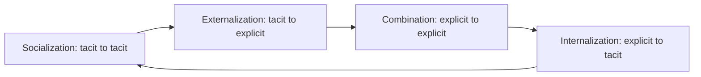

**In simple words:** knowledge wo information hai jisme experience aur understanding judi hoti hai, taaki pata ho kya karna hai. Iske do main types hain, explicit aur tacit, aur Nonaka ka SECI model dikhata hai ki ye ek dusre mein chaar tarah se badalte hain. <Cite id="knowledge-management-wiki-seci" />

**Knowledge ke types**

- **Explicit knowledge** words, numbers ya diagrams mein likha ja sakta hai aur record ho sakta hai, jaise manuals, reports aur databases.
- **Tacit knowledge** experience se bana personal know-how hai jo logon ke dimaag aur haathon mein rehta hai, jaise senior engineer ko faulty machine ka andaza. Cycling manual explicit hai, lekin cycle pe balance banana tacit hai. <Cite id="knowledge-management-wiki-tacit" />

| Point | Tacit knowledge | Explicit knowledge |
|---|---|---|
| Kahan rehta hai | Logon ke mind aur skills mein | Documents aur databases mein |
| Likh sakte hain? | Mushkil ya partly | Haan, aasani se |
| Sharing | Face to face, mentoring | Reading, e-mail, search |
| Example | Doctor ka diagnostic judgment | Hospital ki treatment guideline |
| Main risk | Insaan jaane pe kho jaata hai | Outdated ho jaata hai |

<Cite id="knowledge-management-tp-tacit-explicit" />

Kuch sources **implicit knowledge** bhi add karte hain, jo abhi likha nahi gaya lekin likha ja sakta hai.

**Knowledge conversion ke four modes (SECI model)**

1. **Socialization (tacit to tacit):** log seedha experience share karte hain, dekhkar aur saath practice karke. Example: naya nurse senior nurse ko shadow karta hai.
2. **Externalization (tacit to explicit):** personal know-how ko words, models ya pictures mein daala jaata hai. Example: engineer bees saal ke experience se troubleshooting guide likhta hai.
3. **Combination (explicit to explicit):** existing explicit pieces collect karke naye explicit knowledge mein merge hote hain. Example: branch sales reports ko ek national report mein combine karna.
4. **Internalization (explicit to tacit):** insaan explicit knowledge se seekhta hai aur practice se use apni skill bana leta hai. Example: naya employee manual follow karta hai jab tak procedure second nature na ban jaaye.

**Spiral:** internalization ke baad insaan ke paas richer tacit knowledge hota hai, jise wo phir socialization se share karta hai, isliye har round mein knowledge badhta hai. Nonaka ek shared space **Ba** ki baat bhi karte hain jahan ye hota hai. <Cite id="knowledge-management-nonaka-hbr" />

**Conclusion:** explicit aur tacit knowledge socialization, externalization, combination aur internalization se ek dusre mein badalte rehte hain, aur organizations ko chaaron support karne chahiye.
