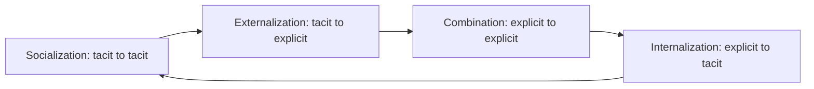

**In simple words:** knowledge is information combined with experience and understanding so that you know what to do. It is of two main types, explicit and tacit, and Nonaka's SECI model shows four ways they turn into each other. <Cite id="knowledge-management-wiki-seci" />

**Types of knowledge**

- **Explicit knowledge** can be put into words, numbers or diagrams and recorded, for example manuals, reports and databases.
- **Tacit knowledge** is personal know-how built from experience and lives in people's heads and hands, for example a senior engineer's feel for a faulty machine. A cycling manual is explicit, but balancing on a bicycle is tacit. <Cite id="knowledge-management-wiki-tacit" />

| Point | Tacit knowledge | Explicit knowledge |
|---|---|---|
| Where it lives | In people's minds and skills | In documents and databases |
| Written down? | Hard or partly | Yes, easily |
| Sharing | Face to face, mentoring | Reading, e-mail, search |
| Example | A doctor's diagnostic judgment | A hospital's treatment guideline |
| Main risk | Lost when the person leaves | Becomes outdated |

<Cite id="knowledge-management-tp-tacit-explicit" />

Some sources add **implicit knowledge** that is not yet written down but could be.

**Four modes of knowledge conversion (SECI model)**

1. **Socialization (tacit to tacit):** people share experience directly by watching and practising together. Example: a new nurse shadows a senior nurse.
2. **Externalization (tacit to explicit):** personal know-how is put into words, models or pictures. Example: an engineer writes a troubleshooting guide from twenty years of experience.
3. **Combination (explicit to explicit):** existing explicit pieces are collected and merged into new explicit knowledge. Example: branch sales reports are combined into one national report.
4. **Internalization (explicit to tacit):** a person learns from explicit knowledge and, through practice, makes it their own skill. Example: a new employee follows a manual until the procedure becomes second nature.

**The spiral:** after internalization the person has richer tacit knowledge, which they share again through socialization, so knowledge grows each time round. Nonaka also describes a shared space called **Ba** where this happens. <Cite id="knowledge-management-nonaka-hbr" />

**Conclusion:** explicit and tacit knowledge keep converting into each other through socialization, externalization, combination and internalization, and organizations should support all four.
