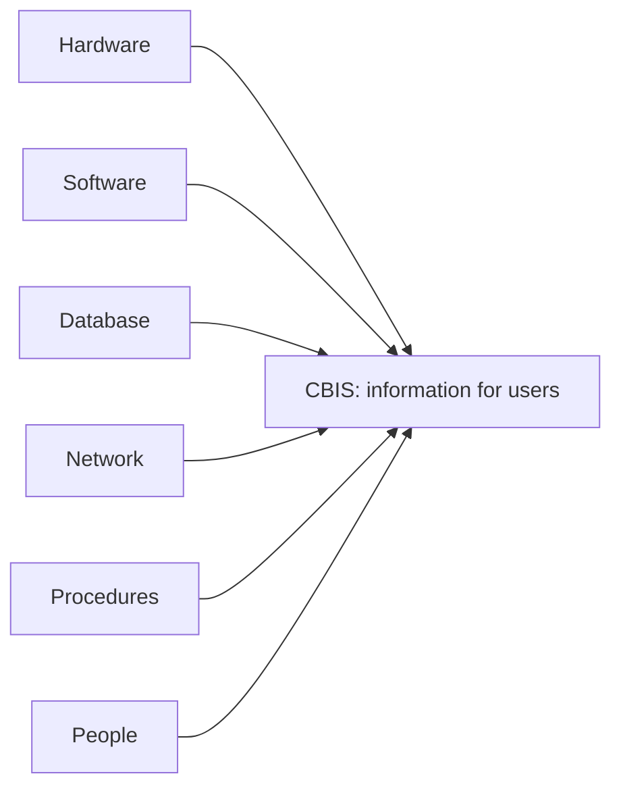

**In simple words:** computer-based information system (CBIS) wo information system hai jo computer technology (hardware, software, databases aur networks) se information collect, process, store aur share karta hai. Manual system slow, error-prone aur search karne mein mushkil hota hai, jabki computer ek second mein hazaaron transactions process kar sakta hai aur koi bhi record turant dhoondh leta hai. <Cite id="is-fundamentals-wiley-rainer" />

**CBIS ke six components** <Cite id="is-fundamentals-wiki-is" />

| Component | Meaning | Example (airline booking) |
|---|---|---|
| Hardware | Physical devices: computers, servers, scanners, printers | Counter computers, boarding-pass printers |
| Software | Programs: system software aur application software | Booking program, operating system |
| Database | Organized data store | Flights, seats, passengers, fares |
| Network | Data share karne ke wired ya wireless links | Airports aur agents ko jodne wala network |
| Procedures | Use karne ke rules aur instructions | Cancellation rules, check-in steps |
| People | Users, operators, analysts, programmers, managers | Passengers, counter staff, IT staff |

Kuch sources paanch components batate hain aur procedures chhod dete hain. Chhe likhna safe hai. <Cite id="is-fundamentals-gfg-components" />

**CBIS ke types (level ke hisaab se)**

| Type | Level | Example |
|---|---|---|
| TPS (Transaction Processing System) | Operational | SBI deposits aur withdrawals |
| OAS aur KWS (Office Automation, Knowledge Work) | Knowledge | Email, CAD |
| MIS (Management Information System) | Middle management | Monthly sales report |
| DSS (Decision Support System) | Middle aur upper management | Free delivery offers ka what-if analysis |
| ESS (Executive Support System) | Top management | CEO dashboard |
| Expert system | Kisi bhi level pe | Medical diagnosis advice |

<Cite id="is-fundamentals-gfg-types" />

**Manual IS vs CBIS:** manual systems slow hote hain, paper use karte hain aur copying errors hoti hain, jabki CBIS fast hai, kam jagah mein bada data store karta hai, turant search karta hai aur network pe share karta hai.

**Advantages:** speed, accuracy, bada storage, instant sharing, better decisions aur routine kaam ka automation.
**Limitations:** high cost, "garbage in, garbage out", security risks, power aur network pe dependence, aur staff ka change ka resistance.

**Applications:** banking (ATMs), railway aur airline reservation, hospital management, college results aur supermarket billing.

**Conclusion:** CBIS tabhi kaam karta hai jab chhe ke chhe components maujood aur sahi hon, kyunki achhe procedures aur trained people ke bina best computers bhi galat information dete hain.
