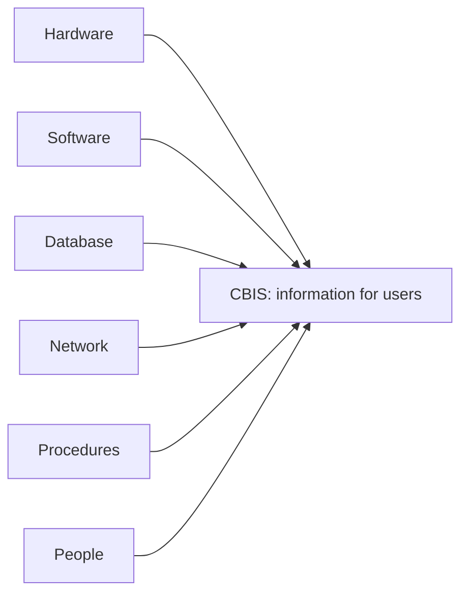

**In simple words:** a computer-based information system (CBIS) is an information system that uses computer technology (hardware, software, databases and networks) to collect, process, store and share information. A manual system is slow, error-prone and hard to search, while a computer can process thousands of transactions a second and find any record instantly. <Cite id="is-fundamentals-wiley-rainer" />

**Six components of a CBIS** <Cite id="is-fundamentals-wiki-is" />

| Component | Meaning | Example (airline booking) |
|---|---|---|
| Hardware | Physical devices: computers, servers, scanners, printers | Counter computers, boarding-pass printers |
| Software | Programs: system software and application software | Booking program, operating system |
| Database | Organized data store | Flights, seats, passengers, fares |
| Network | Wired or wireless links to share data | Network linking airports and agents |
| Procedures | Rules and instructions for use | Cancellation rules, check-in steps |
| People | Users, operators, analysts, programmers, managers | Passengers, counter staff, IT staff |

Some sources list five components and leave out procedures. Writing all six is safe. <Cite id="is-fundamentals-gfg-components" />

**Types of CBIS (by level)**

| Type | Level | Example |
|---|---|---|
| TPS (Transaction Processing System) | Operational | SBI deposits and withdrawals |
| OAS and KWS (Office Automation, Knowledge Work) | Knowledge | Email, CAD |
| MIS (Management Information System) | Middle management | Monthly sales report |
| DSS (Decision Support System) | Middle and upper management | What-if analysis of free delivery offers |
| ESS (Executive Support System) | Top management | CEO dashboard |
| Expert system | Any level | Medical diagnosis advice |

<Cite id="is-fundamentals-gfg-types" />

**Manual IS versus CBIS:** manual systems are slow, use paper and have copying errors, whereas CBIS is fast, stores large data in small space, searches instantly and shares over a network.

**Advantages:** speed, accuracy, large storage, instant sharing, better decisions and automation of routine work.
**Limitations:** high cost, "garbage in, garbage out", security risks, dependence on power and network, and staff resistance to change.

**Applications:** banking (ATMs), railway and airline reservation, hospital management, college results and supermarket billing.

**Conclusion:** a CBIS works only when all six components are present and correct, because the best computers still give wrong information without good procedures and trained people.
