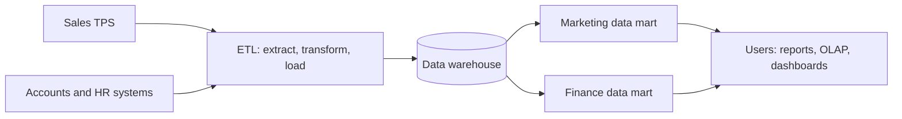

**In simple words:** operational databases transactions jaldi record karne ke liye bane hote hain. Unpar heavy analysis karne se billing slow hoti hai, isliye firms data ko analysis ke liye alag store mein copy karti hain: poori firm ke liye data warehouse aur ek department ke liye data mart. Hotel chain socho: warehouse central kitchen hai aur har data mart ek restaurant ka counter. <Cite id="data-management-ibm-data-mart" />

**Data warehouse:** kai sources se jama kiya hua current aur historical data ka central store, jo analysis ke liye organize hota hai. Bill Inmon ne ise subject-oriented, integrated, time-variant aur non-volatile kaha. <Cite id="data-management-wiki-data-warehouse" />

1. **Subject-oriented:** customer, product ya sales ke around organized, programs ke around nahi.
2. **Integrated:** alag sources ka data ek format aur ek code set mein convert hota hai.
3. **Time-variant:** history rakhi jaati hai, isliye trends dikhte hain.
4. **Non-volatile:** data load hota hai aur read hota hai, roz ke kaam se change nahi hota.

**Data mart:** ek chhota data warehouse jo ek subject ya department pe focus karta hai, jaise marketing ya finance. Ye dependent (warehouse se bana), independent (source systems se bana) ya hybrid ho sakta hai. <Cite id="data-management-ibm-data-mart" />

| Point | Data warehouse | Data mart |
|---|---|---|
| Scope | Poori organization | Ek department ya subject |
| Size | Bada | Chhota |
| Sources | Kai source systems | Kam sources ya warehouse |
| Build time aur cost | Zyada | Kam |
| Users | Kai groups | Ek group |

<Cite id="data-management-gfg-dw-vs-dm" />

**Big Data generation ke do examples** <Cite id="data-management-wiki-big-data" />

1. **Retail transactions:** Walmart ek ghante mein 10 lakh se zyada customer transactions handle karta hai, aur Amazon aur Flipkart har click, search aur order record karte hain.
2. **Social media:** Facebook, Instagram ya X pe har like, share, photo aur video bade data sets banata hai. Aur sources hain sensors, GPS aur Zomato ka order aur rider location data.

**Conclusion:** warehouse decisions ke liye firm-wide view deta hai, data mart faster aur cheaper departmental view deta hai, aur retail aur social media ka big data wo hai jise aise systems ko handle karna padta hai.
