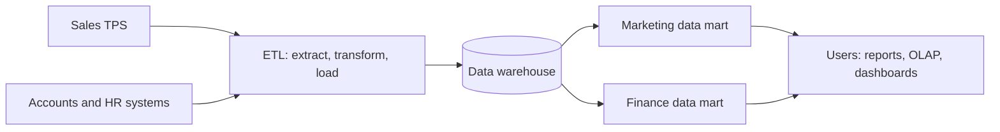

**In simple words:** operational databases are built to record transactions quickly. Heavy analysis on them slows down billing, so firms copy data into a separate store built for analysis: a data warehouse for the whole firm and a data mart for one department. Think of a hotel chain: the warehouse is the central kitchen and each data mart is the counter of one restaurant. <Cite id="data-management-ibm-data-mart" />

**Data warehouse:** a central store of current and historical data gathered from many sources and organized for analysis. Bill Inmon described it as subject-oriented, integrated, time-variant and non-volatile. <Cite id="data-management-wiki-data-warehouse" />

1. **Subject-oriented:** organized around customer, product or sales, not around programs.
2. **Integrated:** data from different sources is converted to one format and code set.
3. **Time-variant:** history is kept, so trends can be seen.
4. **Non-volatile:** data is loaded and read, not changed by daily work.

**Data mart:** a small data warehouse focused on one subject or department, such as marketing or finance. It can be dependent (built from the warehouse), independent (built from source systems) or hybrid. <Cite id="data-management-ibm-data-mart" />

| Point | Data warehouse | Data mart |
|---|---|---|
| Scope | Whole organization | One department or subject |
| Size | Large | Smaller |
| Sources | Many source systems | Few sources or the warehouse |
| Build time and cost | Long and high | Short and low |
| Users | Many groups | One group |

<Cite id="data-management-gfg-dw-vs-dm" />

**Two examples of Big Data generation** <Cite id="data-management-wiki-big-data" />

1. **Retail transactions:** Walmart handles over a million customer transactions an hour, and Amazon and Flipkart record every click, search and order.
2. **Social media:** every like, share, photo and video on Facebook, Instagram or X adds to huge data sets. Other sources are sensors, GPS and Zomato's order and rider location data.

**Conclusion:** the warehouse gives a firm-wide view for decisions, the data mart gives a faster and cheaper departmental view, and big data from retail and social media is what such systems must increasingly handle.
