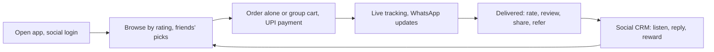

**In simple words:** plan ek food aur grocery delivery app ka hai (Zomato ya Swiggy jaisa) jo phone pe chalta hai (m-commerce) aur social features, jaise reviews, sharing aur referrals, use karta hai taaki customers aayein aur trust bane.

**Definitions:** m-commerce smartphones pe apps, mobile sites ya QR codes se buy, sell aur pay karna hai. <Cite id="e-commerce-wiki-mcommerce" /> Social computing ka matlab hai social media aur online communities use karna jahan users khud content banate aur share karte hain. <Cite id="social-computing-wiki-social-commerce" />

**1. Aim aur users.** Food aur groceries deliver karna aur social features se marketing cost kam karna. Users students, working people aur families hain, saath mein restaurants, shops aur delivery partners.

**2. Social computing features**

- **Social login** (Google, Facebook) aur phone number, taaki lambe form na bharna pade.
- **Photos ke saath ratings aur reviews** dishes, restaurants aur delivery partners ke liye.
- **Share aur refer:** order WhatsApp ya Instagram pe share karo; referral code dono ko discount deta hai.
- **Group cart aur bill splitting** friends ke liye.
- **WhatsApp updates aur chatbot support.**
- **Polls** jahan users naye cuisines ya areas ke liye vote karte hain.
- **Live tracking** jo friend ke saath share ho sakti hai.
- **Social CRM:** X aur Instagram pe mentions dekho aur complaints ka jaldi reply do.

**3. M-commerce parts.** Paas ki shops dhoondhne ke liye GPS, UPI aur wallet payments, offers aur order status ke liye push notifications, aur aise screens jo chhote phones aur weak networks pe chalein. <Cite id="e-commerce-wiki-qcommerce" />

**4. Plan ke phases**

1. Social media listening se market aur rivals ko study karo.
2. Screens aur social features design karo.
3. Customer, restaurant aur delivery-partner sides ko secure payment ke saath build karo.
4. Chhote group ke saath beta test chalao aur feedback lo.
5. Ek area mein influencers aur referral offers ke saath launch karo.
6. Results track karo aur naye areas mein expand karo.

**5. Revenue.** Restaurants se commission, delivery fees, paid promotion aur free delivery ke liye subscription.

**6. Success ke measures.** Downloads, orders per user, repeat orders, ratings, referrals aur complaint response time.

**7. Risks aur controls.**

| Risk | Control |
|---|---|
| Fake reviews | Sirf unhi users ko review karne do jinhone order kiya |
| Location data ki privacy | Consent lo aur data protect karo |
| Kharab complaint ka viral hona | Jaldi refund aur public reply |
| Payment fraud | Secure payment gateways use karo |

<Cite id="social-computing-wiki-smm" />

**Conclusion:** m-commerce ki convenience ko social trust aur word of mouth ke saath milane se delivery app kam marketing cost mein tezi se grow karta hai.
