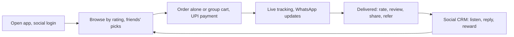

**In simple words:** the plan is for a food and grocery delivery app (like Zomato or Swiggy) that runs on the phone (m-commerce) and uses social features, such as reviews, sharing and referrals, to attract customers and build trust.

**Definitions:** m-commerce is buying, selling and paying through smartphones using apps, mobile sites or QR codes. <Cite id="e-commerce-wiki-mcommerce" /> Social computing means using social media and online communities so users create and share content. <Cite id="social-computing-wiki-social-commerce" />

**1. Aim and users.** Deliver food and groceries and cut marketing cost through social features. Users are students, working people and families, plus restaurants, shops and delivery partners.

**2. Social computing features**

- **Social login** (Google, Facebook) and phone number, so no long form.
- **Ratings and reviews with photos** for dishes, restaurants and delivery partners.
- **Share and refer:** share an order on WhatsApp or Instagram; a referral code gives both people a discount.
- **Group cart and bill splitting** for friends.
- **WhatsApp updates and chatbot support.**
- **Polls** where users vote for new cuisines or areas.
- **Live tracking** that can be shared with a friend.
- **Social CRM:** watch mentions on X and Instagram and reply to complaints quickly.

**3. M-commerce parts.** GPS to find nearby shops, UPI and wallet payments, push notifications for offers and order status, and screens that work on small phones and weak networks. <Cite id="e-commerce-wiki-qcommerce" />

**4. Phases of the plan**

1. Study the market and rivals using social media listening.
2. Design screens and social features.
3. Build the customer, restaurant and delivery-partner sides with secure payment.
4. Run a beta test with a small group and collect feedback.
5. Launch in one area with influencers and referral offers.
6. Track results and expand to new areas.

**5. Revenue.** Commission from restaurants, delivery fees, paid promotion and a subscription for free delivery.

**6. Measures of success.** Downloads, orders per user, repeat orders, ratings, referrals and complaint response time.

**7. Risks and controls.**

| Risk | Control |
|---|---|
| Fake reviews | Allow reviews only from users who ordered |
| Privacy of location data | Ask consent and protect data |
| A bad complaint going viral | Quick refund and public reply |
| Payment fraud | Use secure payment gateways |

<Cite id="social-computing-wiki-smm" />

**Conclusion:** combining m-commerce convenience with social trust and word of mouth gives a delivery app faster growth at lower marketing cost.
