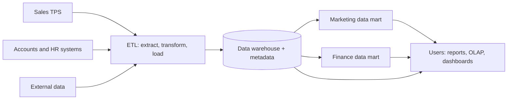

**In simple words:** data warehouse poori company ke liye cleaned, historical data ka ek bada store hai, jo analysis ke liye bana hai. Data mart uska ek chhota hissa hai jo ek department ke liye hota hai. Warehouse ko hotel chain ki central kitchen samjho aur har data mart ko ek restaurant ka counter.

**Ye kyun zaroori hain:** "pichle paanch saal ki region-wise sales" jaise bhaari sawaal billing system ko slow kar dete hain, aur data kai systems mein alag formats mein bikhra hota hai. Isliye data ko ek alag store mein copy kiya jaata hai jo sirf analysis ke liye bana ho.

**Data warehouse**

Definition: kai sources se aaye current aur historical data ka central store, jo analysis aur decision making ke liye organized hai. Bill Inmon ne ise **subject-oriented, integrated, time-variant aur non-volatile** bataya. <Cite id="data-management-tp-dwh-overview" />

- **Subject-oriented:** customer, product ya sales ke hisaab se organized, program ke hisaab se nahi.
- **Integrated:** alag sources ka data ek format aur ek codes ke set mein.
- **Time-variant:** saalon ki history rakhta hai, taaki trends dikhein.
- **Non-volatile:** load hota hai aur padha jaata hai, roz ke kaam se badla nahi jaata.

**Data mart:** ek chhota warehouse jo ek subject ya department pe focus karta hai, jaise marketing ya finance. <Cite id="data-management-ibm-data-mart" /> Types: **dependent** (warehouse se bana), **independent** (seedha source systems se bana) aur **hybrid**.

**Data warehouse versus data mart**

| Point | Data warehouse | Data mart |
|---|---|---|
| Scope | Poori organization, kai subjects | Ek department ya subject |
| Size | Bada | Chhota |
| Sources | Kai source systems | Kuch sources ya warehouse |
| Build time and cost | Lamba aur zyada | Chhota aur kam |
| Users | Kai groups | Ek group |
| Design | Aam taur par top-down | Aksar bottom-up |

<Cite id="data-management-gfg-dw-vs-dm" />

**Organization mein use**

- Retail chain (Walmart, Flipkart) apne warehouse mein festival ke hisaab se store-wise sales study karti hai; uska marketing mart sirf campaign data deta hai.
- Bank customer history analyse karke loan offers design karta hai.

**Advantages:** ek consistent view, trends ke liye history, roz ke kaam ko slow kiye bina tez analysis. **Disadvantages:** warehouse banana costly aur slow hai; kai independent marts "data islands" bana dete hain jinke numbers aapas mein match nahi karte. <Cite id="data-management-wiki-data-warehouse" />

**Conclusion:** warehouse company ko data ka ek bharosemand source deta hai, aur data marts har department ko uska hissa tez aur sasta pahunchate hain.
