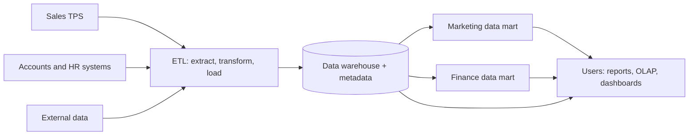

**In simple words:** a data warehouse is one big store of cleaned, historical data for the whole company, built for analysis. A data mart is a small slice of it for one department. Think of the warehouse as a hotel chain's central kitchen and each data mart as one restaurant's counter.

**Why they are needed:** heavy questions like "sales by region for five years" slow down the billing system, and the data is spread over many systems in different formats. So the data is copied into a separate store built only for analysis.

**Data warehouse**

Definition: a central store of current and historical data gathered from many sources, organized for analysis and decision making. Bill Inmon described it as **subject-oriented, integrated, time-variant and non-volatile**. <Cite id="data-management-tp-dwh-overview" />

- **Subject-oriented:** organized by customer, product or sales, not by program.
- **Integrated:** data from different sources in one format and one set of codes.
- **Time-variant:** keeps years of history so trends can be seen.
- **Non-volatile:** loaded and read, not changed by daily work.

**Data mart:** a small warehouse focused on one subject or department, such as marketing or finance. <Cite id="data-management-ibm-data-mart" /> Types: **dependent** (built from the warehouse), **independent** (built directly from source systems) and **hybrid**.

**Data warehouse versus data mart**

| Point | Data warehouse | Data mart |
|---|---|---|
| Scope | Whole organization, many subjects | One department or subject |
| Size | Large | Smaller |
| Sources | Many source systems | Few sources or the warehouse |
| Build time and cost | Long and high | Short and low |
| Users | Many groups | One group |
| Design | Usually top-down | Often bottom-up |

<Cite id="data-management-gfg-dw-vs-dm" />

**Use in an organization**

- A retail chain (Walmart, Flipkart) studies sales per store per festival in its warehouse; its marketing mart serves only campaign data.
- A bank analyses customer history to design loan offers.

**Advantages:** one consistent view, history for trends, fast analysis without slowing daily work. **Disadvantages:** warehouse is costly and slow to build; many independent marts create "data islands" with conflicting numbers. <Cite id="data-management-wiki-data-warehouse" />

**Conclusion:** the warehouse gives the company one trusted source of data, and data marts deliver the part each department needs, quickly and cheaply.
