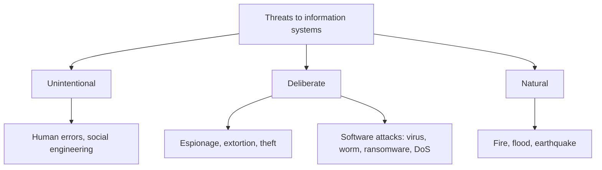

**In simple words:** threat wo cheez hai jo information resource ko nuksaan pahuncha sake. Koi ek protection kaafi nahi hoti, isliye firms controls ki kai layers lagati hain.

**Definitions:** **threat** wo danger hai jo asset ko harm kar sakta hai; **control** wo safeguard hai jo threat ko rokta hai, detect karta hai ya uska asar kam karta hai. <Cite id="note-information-security-wiki-controls" />

**Major threats** <Cite id="is-fundamentals-wiley-rainer" /> <Cite id="note-information-security-tp-threats" />

| Threat | Meaning | Example |
|---|---|---|
| Human error | Staff ki galtiyan | Weak password, galat email, kho gaya laptop |
| Social engineering | Insaan ko bahka ke access lena | Bank ka fake call jo OTP maangta hai; phishing |
| Espionage | Secrets tak unauthorized access | Rival product plans copy karta hai |
| Information extortion | Paise ke liye data lock ya chori karna | Ransomware |
| Identity theft | Kisi ki details use karke us ban jaana | Victim ke naam pe loan |
| Virus aur worm | Virus ko host file chahiye; worm khud phailta hai | WannaCry (2017) |
| Trojan | Useful dikhta hai, harmful code chhupa hota hai | Fake free software |
| Denial of service | Server ko flood karta hai, users andar nahi aa paate | Sale ke din shopping site down |
| Natural | Fire, flood, power failure | Data centre mein paani bhar gaya |

<Cite id="note-information-security-gfg-cyber-attacks" />

**Control ke measures (layers)**

1. **Physical controls:** locks, guards, ID badges, CCTV, UPS aur fire protection.
2. **Access controls:** authentication (password, OTP, fingerprint, aur multi-factor) aur authorization (least privilege: sirf zaroori access).
3. **Communications controls:** firewall, anti-malware, encryption, VPN aur intrusion detection.
4. **Business continuity controls:** regular backups, disaster recovery plan, hot, warm ya cold backup sites.
5. **Audit aur policy:** IT audits, logs, security policy aur staff training.

**Function ke hisaab se:** preventive (firewall), deterrent (warning signs), detective (log monitoring), corrective (backup se restore).

**Risk strategies:** risk accept karo, controls se limit karo, ya transfer karo (cyber insurance).

**Example:** SBI net banking password plus OTP, HTTPS encryption, firewalls aur backup server, sab ek saath use karta hai.

**Conclusion:** threats logon, attackers aur nature se aate hain, isliye technology, people aur policy ke saath defence in depth zaroori hai.
