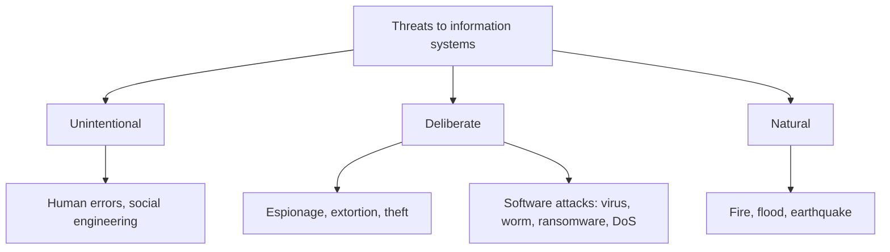

**In simple words:** a threat is anything that can harm an information resource. Because no single protection is enough, firms stack several layers of controls.

**Definitions:** a **threat** is a danger that can harm an asset; a **control** is a safeguard that prevents, detects or reduces the effect of a threat. <Cite id="note-information-security-wiki-controls" />

**Major threats** <Cite id="is-fundamentals-wiley-rainer" /> <Cite id="note-information-security-tp-threats" />

| Threat | Meaning | Example |
|---|---|---|
| Human error | Mistakes by staff | Weak password, wrong email, lost laptop |
| Social engineering | Tricking a person to get access | Fake bank call asking for an OTP; phishing |
| Espionage | Unauthorized access to secrets | Rival copies product plans |
| Information extortion | Locking or stealing data for money | Ransomware |
| Identity theft | Using someone's details to pose as them | Loan in a victim's name |
| Virus and worm | Virus needs a host file; worm spreads alone | WannaCry (2017) |
| Trojan | Looks useful, hides harmful code | Fake free software |
| Denial of service | Floods a server so users cannot enter | Shopping site down on sale day |
| Natural | Fire, flood, power failure | Data centre flooded |

<Cite id="note-information-security-gfg-cyber-attacks" />

**Measures for control (layers)**

1. **Physical controls:** locks, guards, ID badges, CCTV, UPS and fire protection.
2. **Access controls:** authentication (password, OTP, fingerprint, and multi-factor) and authorization (least privilege: only the access needed).
3. **Communications controls:** firewall, anti-malware, encryption, VPN and intrusion detection.
4. **Business continuity controls:** regular backups, disaster recovery plan, hot, warm or cold backup sites.
5. **Audit and policy:** IT audits, logs, security policy and staff training.

**By function:** preventive (firewall), deterrent (warning signs), detective (log monitoring), corrective (restore from backup).

**Risk strategies:** accept the risk, limit it with controls, or transfer it (cyber insurance).

**Example:** SBI net banking uses password plus OTP, HTTPS encryption, firewalls and a backup server together.

**Conclusion:** threats come from people, attackers and nature, so defence in depth with technology, people and policy is needed.
