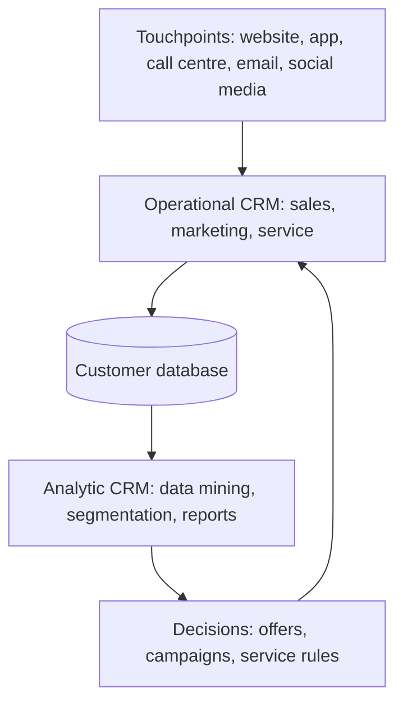

**In simple words:** CRM wo software aur strategy hai jo customer ke baare mein sab kuch ek jagah rakhti hai, taaki koi bhi employee us customer ko achhe se handle kar sake. Jaise kirana wala aapki aadatein yaad rakhta hai, bas yahan millions of customers ke liye.

**Definition:** customer relationship management (CRM) ek strategy hai, jo information systems se supported hoti hai, aur customers ki saari information aur firm ke saath unke contacts ek jagah jama karti hai, taaki firm apne customers ko rakh sake aur badha sake. <Cite id="crm-rainer-iis" />

**Ye kyun zaroori hai:** customer sales, support aur billing, sabse deal karta hai. Agar har team apne alag notes rakhe, to customer ko baar baar kahani sunani padti hai aur complaints bhool jaati hain. Naya customer jodna purane ko rakhne se mehenga padta hai.

**CRM ke types** <Cite id="crm-techtarget-types" /> <Cite id="crm-tpoint-types" />

1. **Operational CRM:** roz ka front-office kaam automate karta hai: sales force automation, marketing automation aur customer service (tickets, call centre, chat). Example: jab aap Flipkart ko late order ki complaint dete ho, agent ko aapke orders aur refund history turant dikhti hai.
2. **Analytic CRM:** stored customer data se patterns dhoondhta hai: segmentation, data mining, customer lifetime value aur churn prediction. Example: Amazon ka "customers who bought this also bought".
3. **Marketing CRM:** customer data se campaigns, loyalty programmes aur targeted offers plan karta hai. Example: Zomato un logon ko lunch offer bhejta hai jo aksar noon ko order karte hain.
4. **Collaborative CRM:** customer information departments aur partners ke beech share karta hai. Example: car maker, dealer aur service centre ko same customer history dikhti hai.

Zyadatar textbooks sirf operational, analytic aur collaborative CRM naam dete hain; "marketing CRM" ko kuch sources chautha type bana dete hain, to agar aapke teacher teen types padhate hain, to marketing ko operational ka hissa maan lo.

| Point | Operational | Analytic | Marketing | Collaborative |
|---|---|---|---|---|
| Aim | Roz ka customer kaam chalana | Data se customers samajhna | Campaigns se customers jodna aur rakhna | Teams aur partners ke beech data share karna |
| Users | Sales aur support staff | Analysts, managers | Marketing team | Sabhi departments, partners |
| Time view | Abhi | Past aur future | Planned campaigns | Chalta hua teamwork |
| Example | Flipkart support ticket | Amazon recommendations | Zomato offer | Car maker with dealer |

<Cite id="crm-gfg-intro" />

**Benefits:** behtar service, repeat sales aur cross-selling. **Limits:** zyada cost, kharab data quality aur staff ka resistance.

**Conclusion:** operational CRM aaj ke customer ko serve karta hai, analytic CRM data se seekhta hai, marketing CRM smarter bechta hai, aur collaborative CRM sabko jodta hai.
