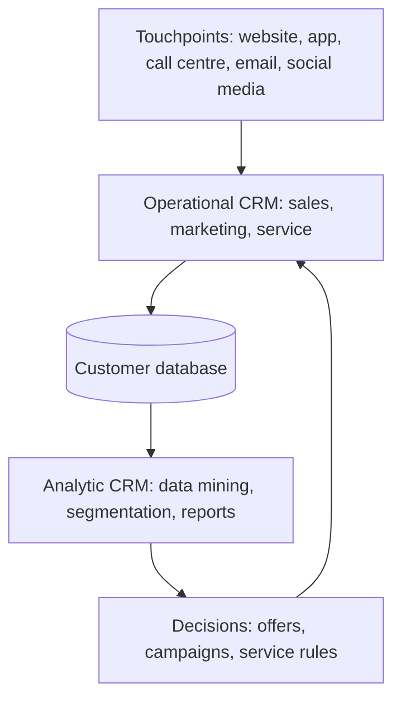

**In simple words:** CRM is software and strategy that keeps everything about a customer in one place, so any employee can treat that customer well. Like a kirana shopkeeper who remembers your habits, only for millions of customers.

**Definition:** customer relationship management (CRM) is a strategy, supported by information systems, that gathers all information about customers and their contacts with the firm in one place, so the firm can keep and grow its customers. <Cite id="crm-rainer-iis" />

**Why it is needed:** a customer deals with sales, support and billing. If each keeps separate notes, the customer repeats the story and complaints are forgotten. Winning a new customer costs more than keeping an old one.

**Types of CRM** <Cite id="crm-techtarget-types" /> <Cite id="crm-tpoint-types" />

1. **Operational CRM:** automates daily front-office work: sales force automation, marketing automation and customer service (tickets, call centre, chat). Example: when you complain to Flipkart about a late order, the agent sees your orders and refund history at once.
2. **Analytic CRM:** studies stored customer data to find patterns: segmentation, data mining, customer lifetime value and churn prediction. Example: Amazon's "customers who bought this also bought".
3. **Marketing CRM:** uses customer data to plan campaigns, loyalty programmes and targeted offers. Example: Zomato sends a lunch offer to people who often order at noon.
4. **Collaborative CRM:** shares customer information across departments and partners. Example: a car maker, its dealer and its service centre see the same customer history.

Most textbooks name only operational, analytic and collaborative CRM; "marketing CRM" is added as a fourth type by some sources, so if your teacher uses three, treat marketing as part of operational.

| Point | Operational | Analytic | Marketing | Collaborative |
|---|---|---|---|---|
| Aim | Run daily customer work | Understand customers from data | Win and keep customers by campaigns | Share data across teams and partners |
| Users | Sales and support staff | Analysts, managers | Marketing team | All departments, partners |
| Time view | Now | Past and future | Planned campaigns | Ongoing teamwork |
| Example | Flipkart support ticket | Amazon recommendations | Zomato offer | Car maker with dealer |

<Cite id="crm-gfg-intro" />

**Benefits:** better service, repeat sales and cross-selling. **Limits:** high cost, poor data quality and staff resistance.

**Conclusion:** operational CRM serves the customer today, analytic CRM learns from the data, marketing CRM sells smarter, and collaborative CRM joins everyone together.
