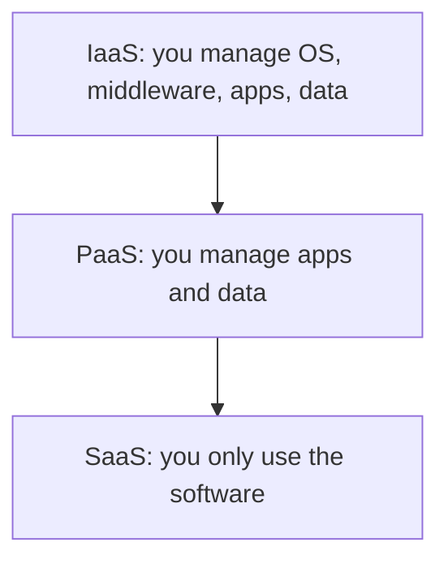

**In simple words:** cloud computing ka matlab hai internet pe computing power, storage aur software kiraye pe lena aur sirf utne ka paisa dena jitna use kiya, apne servers khareedne aur chalane ki jagah. Servers khareedna car khareedne jaisa hai; cloud Ola ya Uber use karne jaisa.

**Definition:** NIST cloud computing ko aisa model batata hai jisme configurable computing resources ke shared pool tak convenient, on-demand network access milta hai, jo bahut kam management effort se jaldi diye aur release kiye ja sakte hain. <Cite id="note-cloud-computing-nist-800-145" />

**Ye kyun zaroori hai:** servers khareedne mein shuru mein bahut kharcha hota hai aur normal dinon mein zyada capacity khaali padi rehti hai. Cloud us fixed cost ko pay-per-use cost bana deta hai.

**Key features (NIST):** on-demand self-service, broad network access, resource pooling, rapid elasticity aur measured service.

**Cloud models**

**A. Service models** <Cite id="note-cloud-computing-ibm-models" />

- **IaaS (Infrastructure as a Service):** virtual machines, storage aur networking. Examples: Amazon EC2, Azure Virtual Machines.
- **PaaS (Platform as a Service):** apps banane aur chalane ke liye ready platform. Examples: Heroku, Google App Engine.
- **SaaS (Software as a Service):** subscription pe ready application. Examples: Salesforce, Microsoft 365, Zoom.

**B. Deployment models** <Cite id="note-cloud-computing-gfg-deploy" />

| Model | Meaning | Example |
|---|---|---|
| Public | Provider ka hai, kai customers share karte hain | AWS pe ek start-up |
| Private | Sirf ek organization use karti hai | Bank ka apna data centre |
| Hybrid | Private aur public jude hue | Retailer customer data private rakhta hai aur sale ke dinon public capacity kiraye pe leta hai |
| Community | Common needs wali organizations share karti hain | Hospitals jo compliance wala cloud share karte hain |

**Service model comparison**

| Point | IaaS | PaaS | SaaS |
|---|---|---|---|
| Aapko milta hai | Virtual machines | Platform | Ready software |
| Skill chahiye | Zyada | Medium | Kam |
| Users | IT administrators | Developers | End users |

<Cite id="note-cloud-computing-gfg-models" />

**Advantages:** kam upfront cost, tez scaling, hardware upkeep nahi. **Disadvantages:** internet pe dependence, security aur privacy ki chinta, vendor lock-in.

**Conclusion:** IaaS sabse zyada control deta hai, SaaS sabse zyada convenience, aur deployment model decide karta hai ki cloud kaun share karta hai.
