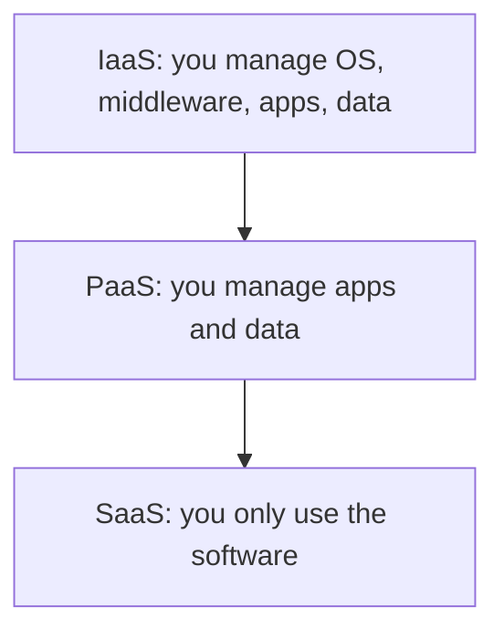

**In simple words:** cloud computing means renting computing power, storage and software over the internet and paying only for what you use, instead of buying and running your own servers. Owning servers is like owning a car; cloud is like using Ola or Uber.

**Definition:** NIST defines cloud computing as a model for convenient, on-demand network access to a shared pool of configurable computing resources that can be rapidly provided and released with minimal management effort. <Cite id="note-cloud-computing-nist-800-145" />

**Why needed:** buying servers costs a lot upfront and most capacity sits idle on normal days. Cloud turns that fixed cost into a pay-per-use cost.

**Key features (NIST):** on-demand self-service, broad network access, resource pooling, rapid elasticity and measured service.

**Cloud models**

**A. Service models** <Cite id="note-cloud-computing-ibm-models" />

- **IaaS (Infrastructure as a Service):** virtual machines, storage and networking. Examples: Amazon EC2, Azure Virtual Machines.
- **PaaS (Platform as a Service):** a ready platform to build and run apps. Examples: Heroku, Google App Engine.
- **SaaS (Software as a Service):** a finished application by subscription. Examples: Salesforce, Microsoft 365, Zoom.

**B. Deployment models** <Cite id="note-cloud-computing-gfg-deploy" />

| Model | Meaning | Example |
|---|---|---|
| Public | Owned by a provider, shared by many customers | A start-up on AWS |
| Private | Used by one organization only | A bank's own data centre |
| Hybrid | Private and public joined together | A retailer keeps customer data private and rents public capacity for sale days |
| Community | Shared by organizations with common needs | Hospitals sharing a compliance-bound cloud |

**Service model comparison**

| Point | IaaS | PaaS | SaaS |
|---|---|---|---|
| You get | Virtual machines | Platform | Finished software |
| Skill needed | High | Medium | Low |
| Users | IT administrators | Developers | End users |

<Cite id="note-cloud-computing-gfg-models" />

**Advantages:** low upfront cost, quick scaling, no hardware upkeep. **Disadvantages:** depends on the internet, security and privacy worries, vendor lock-in.

**Conclusion:** IaaS gives the most control, SaaS the most convenience, and the deployment model decides who shares the cloud.
