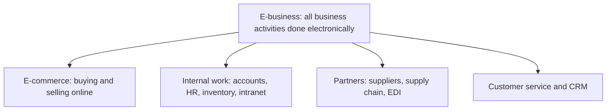

**In simple words:** e-business matlab poore business ko internet aur IT se chalana. E-commerce sirf screen pe shop ka counter hai; e-business poori shop hai: counter, godown, accounts, staff register aur supplier ke calls, sab computers pe.

**Definition:** e-business internet aur information technology ka use karke business ki saari activities karna hai: selling, buying, customer service, partners ke saath kaam aur internal work. <Cite id="e-commerce-wiki-ebusiness" /> <Cite id="e-commerce-rainer-intro-is" />

**E-business ke parts**

1. **E-commerce:** online selling aur buying.
2. **E-procurement:** suppliers se online supplies khareedna.
3. **E-supply chain:** partners ke saath stock aur order data share karna, aksar EDI se, jo purchase orders aur invoices jaise standard documents ka computer-to-computer exchange hai. <Cite id="e-commerce-wiki-edi" />
4. **E-CRM:** chat, email aur social media se customers ko online serve karna.
5. **Internal systems:** ERP, intranet, online HR aur payroll.

**Networks jo use hote hain:** internet (sabke liye), intranet (firm ke andar) aur extranet (chune hue partners ke saath).

**E-commerce versus e-business**

| Point | E-commerce | E-business |
|---|---|---|
| Scope | Sirf buying aur selling | Saari business activities |
| Relation | E-business ka ek hissa | Poora |
| Focus | Customer aur sale | Customers, employees, suppliers, partners |
| Example | Flipkart pe shoes khareedna | Flipkart ka warehouses, supplier portal, HR aur accounts bhi online chalana |

<Cite id="e-commerce-gfg-ecom-vs-ebiz" />

**Benefits:** kam cost, 24-hour service, bada reach, kam paper, live data se tez decisions.

**Limits:** technology cost, security threats, staff training, network pe dependence aur legal rules.

**Examples:** Walmart suppliers ke saath sales data share karta hai taaki wo time pe restock karein; Infosys aur TCS projects, HR aur billing electronically chalate hain; Amazon selling, warehousing, payments aur support ko ek connected system ki tarah chalata hai.

**Conclusion:** e-business sirf website nahi hai; ye poori firm ko digital tareeke se chalane ka tareeka hai.
