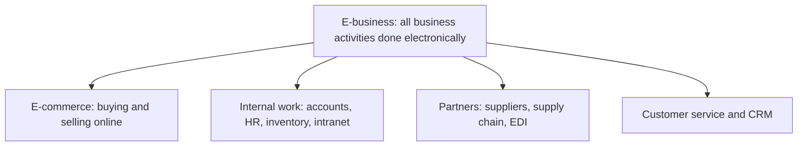

**In simple words:** e-business is running the whole business with the internet and IT. E-commerce is only the shop counter on a screen; e-business is the whole shop: counter, godown, accounts, staff register and supplier calls, all on computers.

**Definition:** e-business is the use of the internet and information technology to carry out all the activities of a business: selling, buying, serving customers, working with partners and managing internal work. <Cite id="e-commerce-wiki-ebusiness" /> <Cite id="e-commerce-rainer-intro-is" />

**Parts of e-business**

1. **E-commerce:** online selling and buying.
2. **E-procurement:** buying supplies online from suppliers.
3. **E-supply chain:** sharing stock and order data with partners, often by EDI, the computer-to-computer exchange of standard documents like purchase orders and invoices. <Cite id="e-commerce-wiki-edi" />
4. **E-CRM:** serving customers online by chat, email and social media.
5. **Internal systems:** ERP, intranet, online HR and payroll.

**Networks used:** internet (everyone), intranet (inside the firm) and extranet (shared with chosen partners).

**E-commerce versus e-business**

| Point | E-commerce | E-business |
|---|---|---|
| Scope | Only buying and selling | All business activities |
| Relation | A part of e-business | The whole |
| Focus | Customer and sale | Customers, employees, suppliers, partners |
| Example | Buying shoes on Flipkart | Flipkart also running warehouses, supplier portal, HR and accounts online |

<Cite id="e-commerce-gfg-ecom-vs-ebiz" />

**Benefits:** lower cost, 24-hour service, wider reach, less paper, faster decisions from live data.

**Limits:** technology cost, security threats, staff training, network dependence and legal rules.

**Examples:** Walmart shares sales data with suppliers so they restock on time; Infosys and TCS run projects, HR and billing electronically; Amazon runs selling, warehousing, payments and support as one connected system.

**Conclusion:** e-business is not just a website; it is the digital way of running the whole firm.
