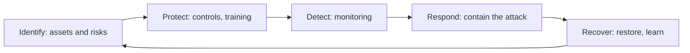

**In simple words:** cyber security matlab computers, networks aur data ko attack se bachana. Koi ek tool ye nahi kar sakta, isliye hum kai measures saath use karte hain: technology, log aur rules.

**Definition:** cybersecurity digital systems aur data ko networks pe hone wale attacks se bachati hai, taaki information confidential, correct aur available rahe. <Cite id="note-information-security-ibm-infosec" />

<Cite id="note-information-security-nist-csf" />

**Measures, examples ke saath** <Cite id="note-information-security-cisa-practices" />

| # | Measure | Example |
|---|---|---|
| 1 | Strong passwords aur multi-factor authentication | Banking apps password ke saath OTP ya fingerprint maangte hain |
| 2 | Software updated rakhna (patching) | 2017 ka Windows patch install hota to WannaCry rukta |
| 3 | Antivirus aur anti-malware | Endpoint protection download scan karke trojan block karta hai |
| 4 | Firewall aur network security | Company firewall known bad addresses ka traffic rokta hai |
| 5 | Encryption | Flipkart checkout pe HTTPS; encrypted laptop disks |
| 6 | Regular backups | Company ransomware ke baad paisa diye bina files restore karti hai |
| 7 | Access control aur least privilege | Clerk payroll database nahi khol sakta |
| 8 | Training aur awareness | Bank mock phishing drills chalata hai |
| 9 | Security policy aur audits | Saalana audit open server ko jaldi pakad leta hai |
| 10 | Monitoring aur incident response plan | Security team infected laptop ko minutes mein isolate kar deti hai |
| 11 | Secure development | Input checks login form pe SQL injection rokte hain |
| 12 | Legal compliance aur reporting | IT Act, 2000 ke under fraud ko cyber crime portal aur CERT-In ko report karna |

<Cite id="note-information-security-gfg-cyber-attacks" />

**Measures kaise jud ke kaam karte hain:** 1, 2, 3, 4, 5, 7 aur 11 attacks rokte hain; 9 aur 10 unhe detect karte hain; 6 aur 10 unse recover karte hain; 8 aur 12 logon aur law se judte hain.

**Conclusion:** cyber security technology, people aur process ka milkar kaam karna hai, aur ise lagataar review karna padta hai kyunki attackers apne tareeke badalte rehte hain.
