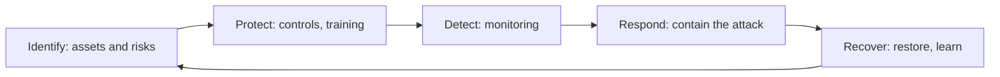

**In simple words:** cyber security is protecting computers, networks and data from attack. No single tool does it, so we use many measures together: technology, people and rules.

**Definition:** cybersecurity protects digital systems and data from attacks over networks, keeping information confidential, correct and available. <Cite id="note-information-security-ibm-infosec" />

<Cite id="note-information-security-nist-csf" />

**Measures with examples** <Cite id="note-information-security-cisa-practices" />

| # | Measure | Example |
|---|---|---|
| 1 | Strong passwords and multi-factor authentication | Banking apps ask for password plus OTP or fingerprint |
| 2 | Keep software updated (patching) | Installing the 2017 Windows patch would have blocked WannaCry |
| 3 | Antivirus and anti-malware | Endpoint protection scans a download and blocks a trojan |
| 4 | Firewall and network security | A company firewall blocks traffic from known bad addresses |
| 5 | Encryption | HTTPS on Flipkart checkout; encrypted laptop disks |
| 6 | Regular backups | A company restores files after ransomware without paying |
| 7 | Access control and least privilege | A clerk cannot open the payroll database |
| 8 | Training and awareness | A bank runs mock phishing drills |
| 9 | Security policy and audits | An annual audit finds an open server early |
| 10 | Monitoring and incident response plan | A security team isolates an infected laptop within minutes |
| 11 | Secure development | Input checks stop SQL injection on a login form |
| 12 | Legal compliance and reporting | Reporting fraud to the cyber crime portal and CERT-In under the IT Act, 2000 |

<Cite id="note-information-security-gfg-cyber-attacks" />

**How the measures fit together:** measures 1, 2, 3, 4, 5, 7 and 11 prevent attacks; 9 and 10 detect them; 6 and 10 recover from them; 8 and 12 deal with people and law.

**Conclusion:** cyber security is technology, people and process working together, and it must be reviewed continuously because attackers keep changing their methods.
