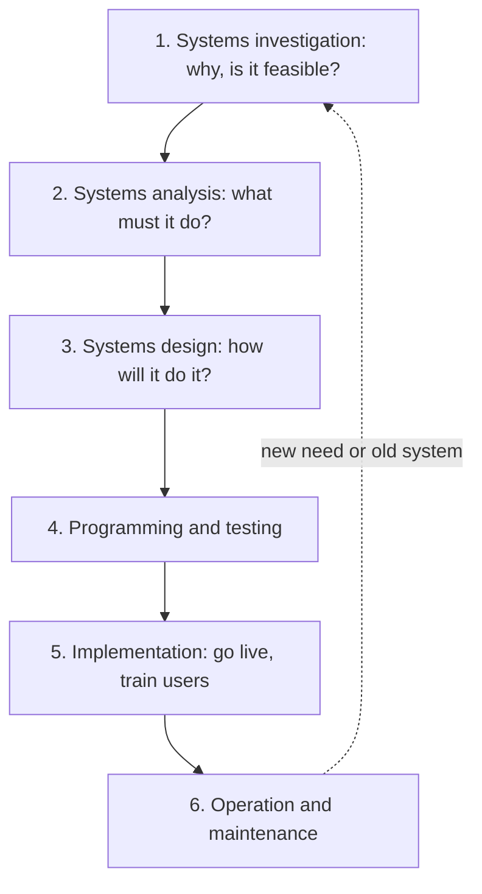

**In simple words:** system development life cycle (SDLC) information system banane ka step-by-step plan hai, pehle idea se leke chalte aur maintain hote system tak. Ye ghar banane jaisa hai: plan, drawing, construction, testing, rehne jaana, repair.

**Definition:** SDLC system development ka traditional structure hai: phases ka ek set, jisme har phase ke tasks aur outputs hote hain. <Cite id="note-sdlc-gfg-sdlc" /> <Cite id="note-sdlc-ibm-sdlc" />

**Phases** (Rainer aur Prince) <Cite id="it-impact-society-rainer-iis7" />

1. **Systems investigation:** asli problem dhoondho aur decide karo ki aage badhna hai ya nahi. Output: feasibility study (technical, economic, behavioural). <Cite id="note-sdlc-wiki-feasibility" />
2. **Systems analysis:** current system study karo aur requirements likho, interviews aur data flow diagrams se.
3. **Systems design:** decide karo ki system requirements ko kaise poora karega: screens, reports, database, hardware, security.
4. **Programming and testing:** code likho aur unit, integration, system aur user acceptance levels pe test karo.
5. **Implementation:** system ko use mein lao, staff ko train karo aur purane system se parallel, direct, pilot ya phased conversion se switch karo.
6. **Operation and maintenance:** system chalao, bugs fix karo, naye rules ke hisaab se adapt karo aur features add karo, phir results review karo.

**Example: hospital appointment app**

| Phase | Kya hota hai |
|---|---|
| Investigation | Patients ghanton queue mein rehte hain; app feasible aur affordable hai |
| Analysis | Receptionists aur doctors ke interviews; needs hain booking, cancelling, SMS reminders |
| Design | Screens, appointment database aur no-double-booking rule |
| Programming and testing | App code hota hai aur real users ke saath test hota hai |
| Implementation | Staff train hota hai; ek department mein pilot, phir sabme |
| Maintenance | SMS timing bug fix hota hai; baad mein video consult add hota hai |

**Advantages:** clear stages, achhe documents aur control. **Disadvantages:** slow aur rigid; users ko system der se dikhta hai; changes costly hain.

**Conclusion:** SDLC aisa system paane ka planned tareeka deta hai jo need ke hisaab se fit ho, aur naye models (prototype, spiral, agile) planning ke badle speed dete hain.
