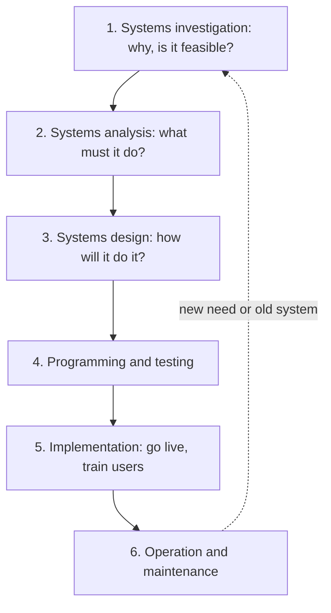

**In simple words:** the system development life cycle (SDLC) is a step-by-step plan for building an information system, from the first idea to a running, maintained system. It is like building a house: plan, draw, build, test, move in, repair.

**Definition:** the SDLC is the traditional structure for system development: a set of phases, each with tasks and outputs. <Cite id="note-sdlc-gfg-sdlc" /> <Cite id="note-sdlc-ibm-sdlc" />

**Phases** (Rainer and Prince) <Cite id="it-impact-society-rainer-iis7" />

1. **Systems investigation:** find the real problem and decide whether to go ahead. Output: a feasibility study (technical, economic, behavioural). <Cite id="note-sdlc-wiki-feasibility" />
2. **Systems analysis:** study the current system and write the requirements, using interviews and data flow diagrams.
3. **Systems design:** decide how the system will meet the requirements: screens, reports, database, hardware, security.
4. **Programming and testing:** write the code and test it at unit, integration, system and user acceptance levels.
5. **Implementation:** put the system into use, train staff and convert from the old system by parallel, direct, pilot or phased conversion.
6. **Operation and maintenance:** run the system, fix bugs, adapt to new rules and add features, then review the results.

**Example: hospital appointment app**

| Phase | What happens |
|---|---|
| Investigation | Patients queue for hours; an app is feasible and affordable |
| Analysis | Receptionists and doctors are interviewed; needs are booking, cancelling, SMS reminders |
| Design | Screens, appointment database and a no-double-booking rule |
| Programming and testing | App is coded and tested with real users |
| Implementation | Staff trained; pilot in one department, then all |
| Maintenance | SMS timing bug fixed; video consult added later |

**Advantages:** clear stages, good documents and control. **Disadvantages:** slow and rigid; users see the system late; changes are costly.

**Conclusion:** the SDLC gives a planned way to get a system that fits the need, and newer models (prototype, spiral, agile) trade planning for speed.
